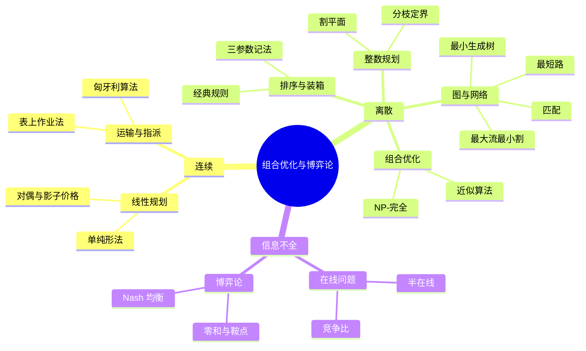

# 《组合优化与博弈论》点化学习系统

## 这本书在讲什么

谈之奕、林凌编著的这本教材（浙江大学出版社）把"怎么在有限资源下做最优决策"这条主线，从连续（线性规划）拉到离散（整数规划、网络、组合优化），再拉到"信息不全"（在线问题）与"多人博弈"（博弈论）。作者的立场很清楚：**难度由结构决定，不是由公式多少决定**——同一类问题，约束矩阵是否全么模、数值是否被规模界住、能不能预知未来，每一个小改动都会让问题从一个复杂度类跳到另一个。全书的方法论就是反复问三件事：模型是什么结构、这个结构能不能被利用、不能利用时能给出什么保证。

## 全书心智模型

**看图说明**：三条分支对应三种"信息与决策结构"——连续可微、离散可枚举、未来不可知。左支靠微积分与线性代数，中支靠组合结构与复杂度理论，右支靠最坏情况分析与不动点。三支共用同一个骨架（决策变量 / 目标 / 约束），只是"约束的性质"和"决策者的数量"不同。

## 学习路径（推荐顺序）

| 步骤 | 章节 | 主题 | 前置 | 检查点 |
|---|---|---|---|---|
| 01 | ch00 | 导言：优化三件套 | 无 | 能用自己的话举一个局部最优反例 |
| 02 | ch01 | 线性规划与对偶 | ch00 | 手算两张单纯形表，x=(4,2) 值 14 |
| 03 | ch02 | 运输与指派 | ch01 | 运输最优 43；指派最优 15 |
| 04 | ch03 | 整数规划 | ch01 | 复算 −202.5 / −198 / −168 三个值 |
| 05 | ch04 | 图与网络优化 | ch01 | MST = 13；最大流 = 4 |
| 06 | ch05 | 组合优化与复杂度 | ch03、ch04 | 能写一个归约的两步证明 |
| 07 | ch06 | 排序与装箱 | ch05 | LPT 得 12；Johnson 得 11 |
| 08 | ch07 | 在线问题 | ch06 | 推出滑雪租赁 2 − 1/N |
| 09 | ch08 | 博弈论 | ch01 | 解出 2×2 博弈值 1/7 |

依赖关系：ch02 与 ch03 都只依赖 ch01，可以交换顺序；ch05 需要 ch03 的整数规划与 ch04 的图论做例子；ch06、ch07、ch08 都建立在 ch05 的复杂度语言上，ch08 另外回接 ch01 的对偶。

## 章节索引

- 第 0 章 导言（难度 ★☆☆）→ `chapters/ch00-导言.md`
- 第 1 章 线性规划（难度 ★★☆）→ `chapters/ch01-线性规划.md`
- 第 2 章 运输与指派（难度 ★★☆）→ `chapters/ch02-运输与指派.md`
- 第 3 章 整数规划（难度 ★★★）→ `chapters/ch03-整数规划.md`
- 第 4 章 图与网络优化（难度 ★★☆）→ `chapters/ch04-图与网络优化.md`
- 第 5 章 组合优化（难度 ★★★）→ `chapters/ch05-组合优化.md`
- 第 6 章 排序与装箱（难度 ★★★）→ `chapters/ch06-排序与装箱.md`
- 第 7 章 在线问题（难度 ★★★）→ `chapters/ch07-在线问题.md`
- 第 8 章 博弈论（难度 ★★★）→ `chapters/ch08-博弈论.md`

## 前置知识（零基础缺口补讲）

| 缺口 | 对应补讲位置 | 学完标志 |
|---|---|---|
| 矩阵运算与求逆 | ch01 概念 3（基与基本解） | 能说清 B⁻¹b 为什么就是基本解 |
| 线性不等式的几何意义 | ch01"看图说明"+ 顶点概念 | 能画出二维可行域并指出顶点 |
| 复杂度记号 O(·) | ch05 概念 1 | 能判断 O(nC) 与 O(n²) 的区别 |
| 概率与期望 | ch07 概念 2（随机化） | 能说明随机化为什么改善期望竞争比 |
| 求导与一阶条件 | ch08 概念 4（Cournot） | 能对 (M−q₁−q₂−c)q₁ 求导并解出反应函数 |
| 图的基本词表 | ch04 概念 1 | 能分清度、路径、圈、树、二分图 |

## 术语表 / 模式库 / 速查表

- 术语：`glossary.md`（55 条，首现章节已标）
- 模式与反模式：`patterns.md`
- 公式速查：`cheatsheet.md`
- 测验：`quiz.md`（18 道章测 + 3 道综合 + 1 个最终检验）
- 抽认卡：`flashcards.md`（32 张，按章打标签）
- 学习路径：`paths/learn.md`
- 跨章概念页：`concepts/`（10 篇）

## 怎么用这套东西

1. 打开 `index.html`（总入口）或本目录的 `组合优化与博弈论学习伴侣.html`（单书版）。
2. 按"学习路径"从左到右推进，每章读完做自测题，错题回看对应概念页。
3. 需要查公式时开 `cheatsheet.md`，需要查术语时开 `glossary.md`。
4. 想从零重推某个核心方法，看同目录下的四个推导页：单纯形法、对偶、NP-完全、Nash 均衡。
