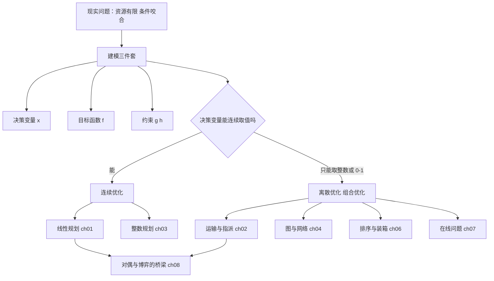

# 导言：运筹学是怎么想问题的

- **难度**：★☆☆ | **预估学时**：2 小时 | **前置**：无（只要会四则运算和看懂"≤"）

## 学习目标

学完本章，你能：

1. 用一句话说清运筹学研究什么，并能举出三个身边的例子。
2. 把一个"该怎么办"的日常问题，写成"决策变量 + 目标函数 + 约束条件"的三件套。
3. 解释为什么"每个零件都最优"不等于"整体最优"。
4. 说出组合优化与线性规划的分界线在哪：连续取值的量，还是只能取整、只能取 0/1 的量。

## 一句话核心

**运筹学做的事，是在资源有限、条件互相牵制的情况下，用一套可计算的模型找出全局最省的那套安排；它的全部功夫都花在把现实问题翻译成数学，再翻译回去。**

## 零基础讲解

### 概念 1：运筹学到底研究什么（难度：基础）

《辞海》给的解释是"主要研究经济、管理与军事活动中能用数量来表达的有关运用、筹划和决策等方面的问题"。这句话可以拆成三条，书里也是按这三条讲的：

- **目的**：把稀缺的资源（人、钱、设备、时间）配置得尽量好，换回尽量大的收益。
- **手段**：以数学为主要工具，把问题量化，建成模型，再算。
- **范围**：盯的是全局的、多阶段的、牵涉多个学科的问题，不接受"局部最优、短期最优、孤立最优"。

换句话说，运筹学不是"更努力地干"，而是"换一种安排方式，让同样的资源产出更多"。田忌赛马是最好的注解：孙膑没有花钱买更好的马，只是改了出场顺序，三场两胜。

### 概念 2：优化模型的三件套（难度：基础）

任何优化问题，落到纸上就三样东西。书里第 1.1 节给出的通用形式是

min f(x)   s.t.  gᵢ(x) ≤ 0，i = 1,2,…,s；hⱼ(x) = 0，j = 1,2,…,t

把符号翻译成人话：

- **x** 是**决策变量**（decision variable）——你能拍板的那些量。今天买几斤米、这条钢管怎么切、圆画在哪个坐标，都是 x。
- **f(x)** 是**目标函数**（objective function）——你要最小化或最大化的那个数。花钱最少、废料最少、半径最小。
- **gᵢ、hⱼ** 是**约束函数**（constraint function）——现实不允许你随便选的那些条件。营养不能缺、钢管长度要对得上、所有点都得落在圆里。

三个词再往下延伸，会带出四个必须分清的词：

| 词 | 含义 | 记忆办法 |
|---|---|---|
| 可行解 | 满足所有约束的一组 x | "合规的方案" |
| 可行域 D | 所有可行解的全体 | "合规方案的集合" |
| 最优解 | 使 f(x) 达到最小的那个 x | "最好的合规方案" |
| 最优值 | 最优解对应的 f(x) | "最好方案的成绩" |

最优解可以有多个（两个人并列第一），最优值一般只有一个（第一名的分数就那一个）。

### 概念 3：为什么"局部最优"会坏事（难度：基础）

书里讲运筹学兴起时点到一个关键：大型系统里，把每个部分单独调到最好，整体可能更糟。

举个例子。一条生产线有三道工序，每道工序都追求"自己的设备利用率最高"：第一道拼命投料，第二道拼命加班，第三道拼命赶工。三道工序各自都漂亮，中间却堆满了半成品，占资金、占场地、还容易过期。整体产出没涨，成本涨了。

这就是运筹学存在的理由：**约束是互相咬合的，必须一起算。** 后面的线性规划、网络流、排序问题，本质都是在处理这种咬合。

### 概念 4：连续与离散，分出了两大块（难度：基础）

决策变量能连续取值（1.7 斤、2.35 米、半径 3.86），问题是**连续优化**，代表是线性规划、非线性规划。

决策变量只能跳着取（派 3 个人不能派 2.5 个、选或不选只能 0 或 1、装箱只能是整箱），问题是**离散优化**，也就是**组合优化**。候选项是有限多个，但数量随规模爆炸——20 个城市就有 20! 种走法。

这条分界线贯穿全书：第 1~3 章是连续与半连续（线性规划、整数规划），第 4~7 章是离散（图与网络、排序装箱、在线问题），第 8 章换了个视角，研究多个决策者互相算计。

## 图示

**看图说明**：从上往下走一遍就是全书的路线。看到"能连续取值吗"这个岔口，就知道后面八章为什么这么排。注意 ch08 有两条箭头进来——对偶理论与矩阵博弈在数学上是同一件事，这是本书最漂亮的一处呼应。

## 类比与实例

### 类比：运筹学像做旅行计划

同样七天假、同样五千块，怎么安排路线和住宿，决定了你玩到多少东西。景点本身没变，钱没变，变的只是**安排**。类比到这里有效；失效的地方在于旅行计划靠感觉，运筹学要求把"值不值"写成可计算的数，否则没法比两个方案谁更好。

### 实例 1：田忌赛马，把 36 种结果摊开算

齐王三匹马按上、中、下出场，田忌的三匹马也各分上中下，但同等级都略输。双方的策略就是三匹马的排列，各 3! = 6 种，组合起来 36 种对阵。

| 田忌策略 \ 齐王策略 | 上中下 | 上中下（同） | ... |
|---|---|---|---|
| 下上中（孙膑建议） | 输、赢、赢 → 2:1 胜 | — | — |

用 +1 记田忌单场胜、−1 记负，把 6×6 的结果写成一张 6 行 6 列的表，你会发现绝大部分格子是负的——这由马匹的绝对劣势决定。但只要齐王固定按"上中下"出，田忌用"下上中"，就是两胜一负。

这里有两个要点，后面第 8 章会严格化：

- 田忌赢不是因为马好，而是因为**对方策略可预测**。对方一旦也随机化，总体看田忌仍然吃亏。
- "总体吃亏"不是感觉，是可以算出来的期望值。

### 实例 2：华罗庚的打麦场选在哪

一村数块麦田，各块产量不同，麦子堆在田边，要集中运到一个打麦场。打麦场设在哪，能使"产量 × 距离"的总和最小？

把道路和田地看成一个图：田和路口是顶点，道路是边，顶点上的数字是产量。华罗庚 1961 年在《数学方法在麦收中的应用》里给了一段口诀：

> 道路无回环，抓各端，最小的进一站。
> 道路有回环，每圈岂一段，化为无回环，然后照样算。

翻译成算法："端"就是只连一条边的**叶子**。每次找出所有叶子里产量最小的那个，把它的产量并到它唯一的邻居上，然后把它和那条边删掉；重复，直到只剩一个顶点，那个顶点就是打麦场。

**为什么可以这么干**（这是零基础最容易卡住的一步）：假设叶子 A 只连着 B，A 的产量比 B 少。麦子必须从 A 经 B 才能出去，所以"把打麦场设在 A 或 A 到 B 之间"不会比"设在 B"更好——把 A 的产量记到 B 头上，最优解不变。叶子一旦删掉，原问题等价地缩小了一圈，继续删就行。这就是"最小的进一站"。

有圈的时候，圈上随便删一条边就变成无圈，但删哪条要试，所以口诀说"每圈岂一段，化为无回环，然后照样算，岂法有不同，结果一一算"。

这个算法后来在文献里叫图上的 **1-median**（1-中位）选址问题，国外类似结果比华罗庚晚了约十年。

### 实例 3：邮递员怎么走才不重复

邮递员要走过每条街道至少一次，回到邮局，怎样走总路程最短？如果街道组成的图能"一笔画"（每条边恰好走一次就回到起点），那答案就是所有边长之和，已经最短。

能不能一笔画，Euler 在 1736 年就解决了，起因是哥尼斯堡七桥问题：七座桥能否各走一次且只一次回到出发点。结论：**一个连通图能一笔画并回到起点，当且仅当每个顶点连出的边数都是偶数**。这样的图叫 Euler 图，那条路线叫 Euler 环游。

不能一笔画怎么办？就得有些边重复走。我国数学家管梅谷在 20 世纪 60 年代初把这个问题系统化，国际上称为**中国邮递员问题**（Chinese Postman Problem）：在图上找一条从起点出发、走遍所有边、回到起点的最短路线。它的解法要到第 4 章学了最短路和匹配才讲得透——先把奇度顶点两两配对，用最短路把它们"补"成偶度。

## 常见误解

- **别以为运筹学就是"算得更快"。** 它首先改的是**模型和安排**。同样的算力，模型错了，算得再快也是错的答案。
- **别以为最优解只有一个。** 最优解是使目标值达到最好的那些方案，可能一大把；最优值才是唯一的那个数。
- **别以为"约束越多问题越难"。** 约束是在帮你砍掉不可能的方案。真正让问题变难的是**离散**：可行解从一条线段变成天文数字个点。
- **别以为"局部最优拼起来就是全局最优"。** 这正是运筹学要反驳的直觉。资源在子系统之间流动时，各自最优会互相拖累。

## 自测题

1. **（单选）**下列哪一组量最适合作为"三件套"里的决策变量？
   A. 目标函数、约束函数、可行域　B. 每天买第 j 种食物的数量 xⱼ　C. 最优值、最优解　D. 系数矩阵、右端向量
   **答案：B**。解析：决策变量是你能拍板的量。A、C、D 都是模型里的派生概念，不是你要决定的量。

2. **（单选）**"20 个城市各去一次、回到出发地，求最短路线"属于哪一类问题？
   A. 连续优化　B. 组合优化　C. 排队论　D. 动态规划
   **答案：B**。解析：路线是城市的一个排列，候选项是有限多个（20! 个），决策对象是离散的排列，属于组合优化。

3. **（填空）**一个连通图能一笔画并回到起点，当且仅当每个顶点的度都是______数。
   **答案：偶**。解析：Euler 环游每经过一个顶点，都要"进一次、出一次"，边成对消耗，所以度数必为偶数；反之这个条件也充分。

4. **（简答）**打麦场算法里，为什么可以把产量最小的叶子 A 的产量直接并到邻居 B？
   **答案：**A 只连 B 一条边，A 的麦子必须经过 B 才能运出去。A 的产量又比 B 少，所以把场设在 A 或 A、B 之间，都不如设在 B 更省。于是"把 A 的产量记到 B 头上、删掉 A"不改变最优解。
   解析要点：两个前提缺一不可——A 是叶子（唯一通道），A 的产量最小（并过去不会让 B 变成"该被搬走的一端"）。

## 复习锚点

- 运筹学 = 稀缺资源 + 数学建模 + 全局视角，三者缺一不算。
- 一切优化问题先写三件套：决策变量、目标、约束。
- 连续 vs 离散，是全书的分水岭；离散的难，难在方案数爆炸。
- 局部最优不等于全局最优，因为约束互相咬合。
