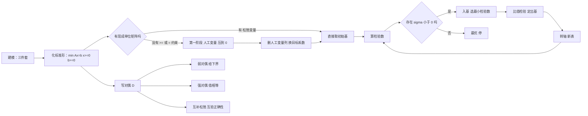

# 第 1 章：线性规划

- **难度**：★★☆ | **预估学时**：6 小时 | **前置**：导言（优化模型三件套）

## 学习目标

学完本章，你能：

1. 把一个带不等式、带负变量、带"最大化"的实际问题，手工改写成标准形。
2. 解释"基""基本解""基本可行解"三者的区别，并说明为什么只需在有限个基本可行解里找最优。
3. 跟着一张单纯形表做完一次转轴，并正确判断"还能改进"还是"已经最优"。
4. 写出一个线性规划的对偶，并用互补松弛条件验证一对解是否同时最优。

## 一句话核心

**线性规划的可行域是一个多面体，目标函数是一张斜放的平面；最优解一定在某个顶点上取到，而顶点恰好对应"基本可行解"，于是无限多的可行解被压缩成有限多个候选点，逐个换着试就成了单纯形法。**

## 零基础讲解

### 概念 1：从三个例子看"线性"（难度：基础）

书里用三个例子上手，正好覆盖三类典型结构。

**例 1.1 食谱问题**（Stigler 1945 年提出，他后来拿了 1982 年诺贝尔经济学奖）。设第 j 种食物每天吃 xⱼ 个单位，单价 cⱼ；第 i 种营养成分在第 j 种食物里含量为 aᵢⱼ，每天至少需要 bᵢ。模型是

min  ∑ⱼ cⱼxⱼ　s.t.  ∑ⱼ aᵢⱼxⱼ ≥ bᵢ（i = 1,…,m），xⱼ ≥ 0

书上特意点了一句：`xⱼ ≥ 0` 是**容易漏掉的隐含约束**。现实里没有"吃负三斤米"这回事，但写模型时忘了它，算出来的解可能真的出现负数。

**例 1.2 下料问题**。15 米长钢管若干，要切出 7 米、5 米、4 米三种短管，数量分别 200、150、100 根，怎么切最省料？

先枚举所有可行的切割方式（一根长管切成哪几段、剩多少），每种方式记为一个列，设用第 j 种方式切 xⱼ 根长管，目标是最小化用的长管总数。这个例子里 xⱼ 还必须是非负**整数**——同一根钢管不能切 2.5 回。这一步"整数"的要求，就是第 3 章整数规划的入口。

**例 1.3 最小覆盖圆**。平面上给 n 个点，找一个面积最小的圆把它们全罩住。设圆心 (x₀,y₀)、半径 ρ，约束是 (xᵢ−x₀)² + (yᵢ−y₀)² ≤ ρ²。

这里的约束函数是二次的，不是线性规划；书里用一个代换把它"压"成线性：令 u = x₀、v = y₀、w 满足 ρ² = u²+v²−w，约束变成 u²+v²−2xᵢu−2yᵢv+ xᵢ²+yᵢ² ≤ 2w 这类形式，最优化的是 w 的线性表达式——这是**二次规划**的典型手法。

三个例子给出的分类线索：约束和目标都是线性 → 线性规划；变量还要取整 → 整数规划；出现平方、乘积 → 非线性规划。

### 概念 2：标准形，以及把任何线性规划塞进标准形（难度：基础）

标准形有四条硬规定：

1. 目标**极小化**；
2. 右端常数 bᵢ **非负**；
3. 所有决策变量**非负**；
4. 除变量范围外，**约束全是等式**。

写成矩阵就是

min cᵀx　s.t. Ax = b，x ≥ 0，b ≥ 0

其中 A = (aᵢⱼ) 是 m×n 系数矩阵，c 是价格（费用）系数向量，b 是右端向量。可行域 D = {x | Ax = b, x ≥ 0}。

不符合的四条，各有对付办法：

| 毛病 | 改法 |
|---|---|
| 求 max cᵀx | 改成 min −cᵀx，最优解不变，最优值取相反数 |
| 某个 bᵢ < 0 | 该约束两边同乘 −1 |
| 某个 xⱼ ≤ 0 | 令 xⱼ = −xⱼ′，xⱼ′ ≥ 0 |
| xⱼ 无符号限制（可正可负） | 拆成两个非负变量之差 xⱼ = xⱼ′ − xⱼ″ |
| 不等式 aᵢx ≤ bᵢ | 加**松弛变量** sᵢ ≥ 0，变成 aᵢx + sᵢ = bᵢ |
| 不等式 aᵢx ≥ bᵢ | 减**剩余变量** sᵢ ≥ 0，变成 aᵢx − sᵢ = bᵢ |

松弛变量的现实含义很直白：**没用完的产能**。它在前面的约束里不占目标函数的系数（c = 0），但它实实在在是一个变量，会出现在单纯形表里。

### 概念 3：基、基本解、基本可行解（难度：进阶）

A 是 m×n 矩阵，n > m。**基**（basis）就是从 A 的 n 个列里挑出 m 个**线性无关**的列组成的方阵 B。选定了 B，剩下的列拼成 N，变量也相应分成 x_B（基变量）和 x_N（非基变量）。

方程 Ax = b 可以写成 Bx_B + Nx_N = b。两边左乘 B⁻¹：

x_B = B⁻¹b − B⁻¹N x_N

现在**强行令所有非基变量取 0**，就得到唯一的一组解 x = (B⁻¹b, 0)。这叫**基本解**。如果这个基本解里基变量的值还都 ≥ 0，它就是**基本可行解**（BFS），此时 B 叫**可行基**。

一句话记：**基本解 = 让非基变量全为 0 换来的解；基本可行解 = 基本解里没有负分量。**

**定理 1.1（线性规划基本定理）**：若线性规划有可行解，则必有基本可行解；若有有限最优解，则必有最优基本可行解。

这条定理是单纯形法的全部合法性来源。基的个数最多 C(m,n) 个，所以基本可行解最多 C(m,n) 个——**有限个**。于是"在无穷多个可行解里找最优"变成了"在有限个点上比大小"。

几何上，每个基本可行解对应可行域多面体的一个**顶点**。二维时你一眼能看出来：三角形区域的三个角，就是三个基本可行解。

### 概念 4：单纯形法的一次转轴（难度：进阶）

给定一个可行基 B 和对应的基本可行解，问题是：**还能不能更好？往哪走？**

把目标函数也用基变量表示。由 x_B = B⁻¹b − B⁻¹Nx_N，代入 cᵀx：

cᵀx = c_BᵀB⁻¹b + (c_Nᵀ − c_BᵀB⁻¹N) x_N

第一项是当前的目标值（常数，改不了），第二项里每个非基变量 xⱼ 的系数

σⱼ = cⱼ − c_BᵀB⁻¹aⱼ

叫**检验数**（reduced cost）。它的含义是：**xⱼ 从 0 增加一个单位，目标值变化多少。**

- 若所有 σⱼ ≥ 0：任何非基变量增大都会让目标变大或不变，当前解已经是**最优解**。
- 若存在 σⱼ < 0：让 xⱼ 从 0 增大，目标会变小，值得走。选它**入基**。

但 xⱼ 不能无限增大——它一增大，基变量就得跟着变（x_B = B⁻¹b − B⁻¹aⱼ xⱼ）。哪个基变量先掉到 0，它就是**出基变量**。判断办法是**比值检验**：

θ = min{ (B⁻¹b)ᵢ / (B⁻¹aⱼ)ᵢ | (B⁻¹aⱼ)ᵢ > 0 }

取到最小比值的那个基变量出基。这一步保证新的解仍然可行（不会有负分量）。入基列与出基行的交叉元素叫**枢轴元**，用它做一次高斯消元（**转轴**），就得到下一张单纯形表。

被选中的入基变量 xⱼ 与出基变量 xᵢ 的身份互换，其余不变。目标值改变量恰好是 σⱼ·xⱼ（新的 xⱼ 取值）。

### 概念 5：退化、循环与两阶段法（难度：高难）

两个坑必须知道。

**退化**：比值检验出现并列最小值时，可能有一个基变量取值为 0 却仍在基里。此时转轴一次，目标值可能一点没降。理论上存在**循环**——反复转轴回到同一张表，永远算不完。Beale 1955 年给出了第一个循环例子。Bland 在 1977 年给出规则：入基选**下标最小**的负检验数变量，出基并列时也选下标最小的，可以证明不循环。实践中循环极罕见，工程实现多用摄动法或直接加迭代上限。

**初始可行基从哪来**：标准形里如果约束是 `≤`，松弛变量天然构成单位矩阵，初始基唾手可得；但如果约束里有 `≥` 或 `=`，就没有现成的单位矩阵。这时引入**人工变量**，构造辅助问题

min  ∑ 人工变量　s.t. 原约束 + 人工变量 = b，全部变量 ≥ 0

第一阶段：用单纯形法把这个辅助问题的最优值压到 0（若压不到 0，说明原问题**无可行解**）。第二阶段：删掉人工变量所在的列，换上原目标函数的系数，从第一阶段得到的可行基继续算。这套流程叫**两阶段法**。书上的例 1.6 里，第一阶段从可行域外的原点出发走到可行域的一个顶点，第二阶段在这个可行域上沿边界移动到最优解，画在图上非常直观。

### 概念 6：对偶——同一个问题的另一张脸（难度：高难）

原问题（P）和它的对偶（D）这样配对：

(P) min cᵀx　s.t. Ax ≥ b，x ≥ 0
(D) max wᵀb　s.t. wᵀA ≤ cᵀ，w ≥ 0

对应关系是机械的：**（P）的每个约束 ↔（D）的一个变量；（P）的每个变量 ↔（D）的一个约束；目标从 min 变 max；系数矩阵转置；b 和 c 换位置。** 不等式方向也反过来。

四个定理撑起整个对偶理论：

- **弱对偶**：只要 x 是（P）的可行解、w 是（D）的可行解，就有 **wᵀb ≤ cᵀx**。（D）的任何可行解都是（P）最优值的一个下界——这正是"猜身高"式的用法：不用解原问题，也能给出一个保证的下界。
- **定理 1.4**：（P）和（D）**都有最优解**，当且仅当两者**都有可行解**。
- **定理 1.5（强对偶）**：（P）或（D）有一个有最优解，则另一个也有，且**目标值相等**。
- **定理 1.6（互补松弛）**：x、w 同时最优的充要条件是

wᵀ(Ax − b) = 0　且　(cᵀ − wᵀA)x = 0

展开成人话就是两条"如果—那么"：

1. 若（D）的第 i 个变量 wᵢ > 0，则（P）的第 i 个约束必然**取等号**；反之若（P）某约束有松弛（严格不等），对应 wᵢ 必为 0。
2. 若（P）的第 j 个变量 xⱼ > 0，则（D）的第 j 个约束必然**取等号**；反之若（D）某约束有松弛，对应 xⱼ 必为 0。

**互补松弛的用法**：它让你能"猜一个解，验一下"。书上例 1.8 就是这么做的——（D）只有两个变量，容易枚举，求出（D）的最优解后，用互补松弛反推出（P）的哪些约束必须取等号，直接把（P）的解解出来，省掉一整套单纯形迭代。

**为什么对偶重要**：wᵢ 有个名字叫**影子价格**（shadow price）。它表示"第 i 种资源多给你一个单位，总成本能降多少"。管理者真正关心的常常不是 x，而是这些价格信号。另外，对偶理论在第 8 章会以**矩阵博弈**的面目再出现一次：LP 的对偶就是零和博弈的"值"。

### 概念 7：算法简史，为什么"快"是个数学问题（难度：进阶）

- 1947 年 Dantzig 提出线性规划模型与单纯形法。此前 Kantorovich 1939 年已有等价工作，但长期未获重视。
- 1972 年 Klee 和 Minty 造出一族多面体，单纯形法在其上要走**指数**步。所以单纯形法最坏情况不是多项式算法。
- 1979 年 Khachiyan 把椭球法用于线性规划，给出**第一个多项式时间**算法。当时的轰动程度不亚于一颗人造卫星，《纽约时报》都报道了。
- 1984 年 Karmarkar 提出**内点法**，理论多项式、实践也快，从此"大规划"有了和单纯形法并行的第二条路线。

要点：可行性、最优性是**组合**问题（选哪个基），而路径长短是**复杂度**问题。这两件事分开看，才不会把"理论上界"和"实际表现"混为一谈。

## 图示

**看图说明**：左半是一条算法流水线，右半是对偶这条"旁路"。注意 H 这个判断框——它就是单纯形法唯一的出口条件。图上没画循环风险（退化），那属于要单独处理的边角。

## 类比与实例

### 类比：在多面体上摸顶点

把可行域想成一顶帐篷，目标函数想成"海拔高度沿某个方向均匀变化"。你站在一个顶点，往哪边走都只能沿边移动。检验数为负，说明沿这条边往下走；比值检验告诉你走多远会先撞到别的边（撞到就换条边走）。走不动了，就是帐篷最低的那个角。

类比失效的位置：帐篷有面，可行域在 n 维空间里也有面，但单纯形法**从不穿过内部**，只在边界上沿边行走——这也是内点法要反着来的原因：它专门从内部穿过去。

### 实例：手算一张单纯形表

**问题**：max 2x₁ + 3x₂，s.t. x₁ + 2x₂ ≤ 8，2x₁ + x₂ ≤ 10，x₁, x₂ ≥ 0。

**第一步，化标准形**（max 改 min，加松弛变量）：

min −2x₁ − 3x₂　s.t. x₁ + 2x₂ + s₁ = 8，2x₁ + x₂ + s₂ = 10，x₁,x₂,s₁,s₂ ≥ 0

**第二步，初始表**。基 B = (s₁,s₂) 对应单位矩阵，初始解 x = (0,0,8,10)，目标值 0。

检验数 σ = cⱼ − c_BᵀB⁻¹aⱼ。此刻 c_B = (0,0)，所以 σ 就是 c 本身：

| | x₁ | x₂ | s₁ | s₂ | 右端 |
|---|---|---|---|---|---|
| s₁ 行 | 1 | **2** | 1 | 0 | 8 |
| s₂ 行 | 2 | 1 | 0 | 1 | 10 |
| 检验数 σ | −2 | **−3** | 0 | 0 | 目标 0 |

**第三步，第一次转轴**。x₂ 的 σ = −3 最小，入基。比值检验：8/2 = 4，10/1 = 10，取 4 → s₁ 出基，枢轴元是第 1 行第 2 列的 2。

第 1 行除以 2：`[1/2, 1, 1/2, 0 | 4]`。
第 2 行减去第 1 行的 1 倍：`[3/2, 0, −1/2, 1 | 6]`。

新基 (x₂, s₂)，c_B = (−3, 0)：

| | x₁ | x₂ | s₁ | s₂ | 右端 |
|---|---|---|---|---|---|
| x₂ 行 | 1/2 | 1 | 1/2 | 0 | 4 |
| s₂ 行 | **3/2** | 0 | −1/2 | 1 | 6 |
| 检验数 σ | **−1/2** | 0 | 3/2 | 0 | 目标 −12 |

σ₁ = −2 − (−3)(1/2 + 0) = −2 + 3/2 = −1/2 < 0，还能改进，x₁ 入基。比值：4/(1/2) = 8，6/(3/2) = 4，取 4 → s₂ 出基。

**第四步，第二次转轴**。第 2 行除以 3/2：`[1, 0, −1/3, 2/3 | 4]`。第 1 行减去第 2 行的 1/2：`[0, 1, 2/3, −1/3 | 2]`。

| | x₁ | x₂ | s₁ | s₂ | 右端 |
|---|---|---|---|---|---|
| x₂ 行 | 0 | 1 | 2/3 | −1/3 | 2 |
| x₁ 行 | 1 | 0 | −1/3 | 2/3 | 4 |
| 检验数 σ | 0 | 0 | 1/3 | 4/3 | 目标 −14 |

所有 σ ≥ 0，停。解 x = (4, 2)，原问题 max 值 = 2·4 + 3·2 = **14**。

**自己验一遍**：约束 4 + 2·2 = 8（刚好用满），2·4 + 2 = 10（刚好用满），可行。再看 (0,4) 给 12、(5,0) 给 10，都不如 14——顶点全试过，14 确实是最优。

**第五步，写对偶并对照**。上面这个 max 问题的对偶是

min 8w₁ + 10w₂　s.t. w₁ + 2w₂ ≥ 2，2w₁ + w₂ ≥ 3，w ≥ 0

解得 w₁ = 4/3、w₂ = 1/3，对偶目标 = 8·4/3 + 10·1/3 = **14**，和原问题相等，强对偶成立。

互补松弛核对：x₁ = 4 > 0，所以对偶第 1 个约束必须取等号——4/3 + 2/3 = 2 ✓；x₂ = 2 > 0，对偶第 2 个约束取等号——8/3 + 1/3 = 3 ✓；原问题两个约束都取等号（没有松弛），所以 w₁、w₂ 都允许不为 0 ✓。三条全部对上。

## 常见误解

- **别以为"最优解在顶点"是万能结论。** 它依赖两个前提：可行域是**有界多面体**（更准确地说，最优值有限可达）、目标是**线性**。目标改成非线性（比如最小覆盖圆的面积），最优解可能落在内部。
- **别以为检验数等于 0 就意味着可以继续走。** σⱼ = 0 时沿该方向目标不变，走与不走最优值都一样，此时**存在多个最优解**。很多例子（两个约束同时取等）都是这种情况。
- **别以为松弛变量是"凑数"的。** 它是唯一把不等式改成等式的手段，且在解里代表真实含义：剩余产能、未用完的预算、闲置的时间。
- **别以为对偶只是个"数学游戏"。** 弱对偶给出的是**可验证的下界**，哪怕原问题算不动，你也能证明"少于 14 不可能"。
- **别以为单纯形法多项式时间。** 它在实际数据上通常很快，但最坏情况是指数的，Klee–Minty 例子就是反证。

## 自测题

1. **（单选）**把 `max 5x₁ − 2x₂，s.t. x₁ + x₂ ≥ 3，x₁,x₂ ≥ 0` 化成标准形，第一行应该是
   A. min 5x₁ − 2x₂，加松弛变量　B. min −5x₁ + 2x₂，减剩余变量　C. min −5x₁ + 2x₂，加松弛变量　D. 不用改
   **答案：B**。解析：max 要翻成 min（系数取反）；`≥` 约束要减一个非负剩余变量才变成等式。

2. **（单选）**某个基本解里出现了 x_B 的负分量，它是什么？
   A. 基本可行解　B. 退化的基本可行解　C. 基本解但不可行　D. 最优解
   **答案：C**。解析：叫"基本解"是因为非基变量全为 0；"可行"额外要求全部分量非负。负分量的基本解不可行。

3. **（填空）**用单纯形法，若某张表里所有检验数都 ≥ 0，则当前基本可行解是______。
   **答案：最优解**。解析：任何非基变量增大都只会让目标变大或不变，边界上再走不会更好。

4. **（简答）**强对偶定理说的是"一个有问题就有最优解，另一个也有且值相等"。它为什么要求"有最优解"而不是"有可行解"？
   **答案：** 两个都可行但都没有最优解（一个无界、一个不可行）是可能的。书上例 1.7 就构造了可行域双双为空的情形；更一般地，"可行"只保证有候选方案，"有最优解"才保证目标值有限可达。定理 1.4 说的是"都有最优解 ↔ 都有可行解"，但那需要把"无界"这种情形排除在外。

5. **（简答）**一个 LP 的最优解里 x₁ = 0 且第一个约束有 2 个单位松弛（Ax−b 的第一分量 = 2），它的对偶最优解 w 满足什么？
   **答案：** 由互补松弛，w₁ × 2 = 0 → **w₁ = 0**。含义是：第一种资源还有 2 单位没用完，它对目标值的边际贡献为零，影子价格就是 0。

## 复习锚点

- 标准形四条件：min、b ≥ 0、x ≥ 0、全等式；不等式靠松弛/剩余变量转。
- 顶点 = 基本可行解；基最多 C(m,n) 个，所以搜索空间有限。
- 单纯形法三步循环：算检验数 → 选负的入基 → 比值检验定出基 → 转轴。
- 对偶：弱对偶给下界，强对偶说值相等，互补松弛用来互相验证。
- 单纯形法最坏指数（Klee–Minty），椭球法与内点法是多项式路线。
