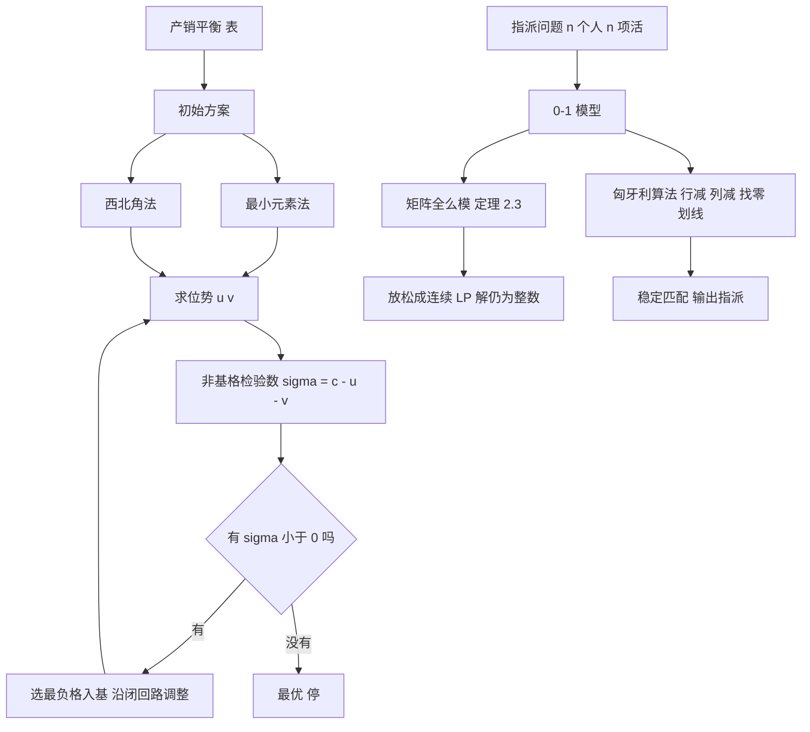

# 第 2 章：运输问题与指派问题

- **难度**：★★☆ | **预估学时**：5 小时 | **前置**：第 1 章（标准形、基本可行解、检验数、对偶）

## 学习目标

学完本章，你能：

1. 写出产销平衡的运输问题模型，并解释为什么它的系数矩阵秩只有 m+n−1。
2. 用最小元素法给出初始调运方案，再用位势法算出检验数判断最优。
3. 说明指派问题为什么虽然是 0-1 规划，却能用连续线性规划的方法精确求解。
4. 用匈牙利算法在成本矩阵上做行列缩减与零覆盖，走完整条迭代。
5. 说清"稳定婚姻"里"稳定"的定义，并解释延迟接受算法为什么一定得到稳定匹配。

## 一句话核心

**运输问题和指派问题是同一类"把货/人对着格子分"的问题，它们的约束矩阵结构特殊（全么模），所以整数最优解可以从连续松弛里直接得到——这是全书里"离散问题被连续方法吃掉"的最典型案例。**

## 零基础讲解

### 概念 1：运输问题长什么样（难度：基础）

m 个产地 A₁…Aₘ，产量 aᵢ；n 个销地 B₁…Bₙ，销量 bⱼ；从 Aᵢ 到 Bⱼ 的单位运费 cᵢⱼ。决策变量 xᵢⱼ = 从 Aᵢ 运到 Bⱼ 的数量。

min ∑ᵢ∑ⱼ cᵢⱼ xᵢⱼ
s.t.  ∑ⱼ xᵢⱼ = aᵢ（i = 1,…,m，产地全运出）
      ∑ᵢ xᵢⱼ = bⱼ（j = 1,…,n，销地全满足）
      xᵢⱼ ≥ 0

两个前提要记住：

- **产销平衡**：∑aᵢ = ∑bⱼ。不平衡时加一个**虚设产地**或**虚设销地**，运费设 0（或足够大的 M，看你想不想强制它不运），把差额补齐。
- 若模型是"最大化利润"，把 pᵢⱼ 换成 cᵢⱼ = −pᵢⱼ 或 cᵢⱼ = M − pᵢⱼ 即可。两种换法**最优解相同，最优值不同**——书上专门提醒这一点，因为很多人会拿两个最优值直接比。

矩阵形状值得看一眼：每行是"某产地运往各销地"，每列是"各产地运往某销地"。**定理 2.1**：m, n ≥ 2 时，rank(A) = m + n − 1。

为什么少一个秩？把所有行加起来，前 m 行之和等于各产地总产量，后 n 行之和等于各销地总销量，产销平衡使这两组和相等——行向量线性相关，秩必然掉 1。这也解释了一个现象：**运输问题的基本可行解只有 m+n−1 个基变量**，不是 m+n 个。所以基格数固定，多出来的非零格一定构成闭回路。

### 概念 2：表上作业法——先给一个初始方案（难度：基础）

运输问题的约束矩阵太大（m×n 个变量），直接上单纯形法不划算。实际做法是把它画成一张表，直接在表上操作，这就是**表上作业法**。

第一步，给初始可行解。常用的两种：

- **最小元素法**：每次在运费最小的格子里尽量多安排，把该行（或该列）的需求满足掉，划掉它，继续。
- **西北角法**：从左上角开始，能填多少填多少，按行、列交替推进。简单但经常离最优很远。

第二步，检验。这里用**位势法**：给每个产地一个 uᵢ、每个销地一个 vⱼ，要求在所有**基格**（有运量的格子）上满足

uᵢ + vⱼ = cᵢⱼ

基格有 m+n−1 个，未知数有 m+n 个，所以总有一个自由变量，随便令 u₁ = 0 就能全部解出来。然后对每个**非基格**算

σᵢⱼ = cᵢⱼ − (uᵢ + vⱼ)

这就是检验数。**全部 σᵢⱼ ≥ 0 就是最优**；有负的，选最负的格子入基，沿**闭回路**调整运量（回路上加减同一个 θ，θ 取回路上最小运量），再重算位势。

位势 (u, v) 其实就是第 1 章对偶变量在运输问题里的长相：uᵢ 是产地 i 的影子价格，vⱼ 是销地 j 的影子价格。运费减去两个影子价格，剩下的就是这个格子"值不值得用"。

### 概念 3：指派问题（难度：基础）

n 项工作分给 n 个人，一人一项，第 i 人做第 j 项要 cᵢⱼ 时间，让总时间最短。决策变量取 0-1：

xᵢⱼ = 1 若第 i 人做第 j 项，否则 0
min ∑ᵢ∑ⱼ cᵢⱼ xᵢⱼ　s.t.  ∑ⱼ xᵢⱼ = 1，∑ᵢ xᵢⱼ = 1，xᵢⱼ ∈ {0,1}

第一组"每行恰一个 1"（每人只干一项），第二组"每列恰一个 1"（每项只由一人干）。可行解就是**排列**，一共 n! 个。

难度立刻显现：n = 20 时，20! ≈ 2.4×10¹⁸，暴力枚举永远算不完。可它偏偏有个多项式算法，原因在下一节。

### 概念 4：为什么 0-1 规划能当线性规划解（难度：高难）

关键在于**全么模矩阵**（totally unimodular）。定义：矩阵 A 的**任意**子方阵的行列式都只能是 0、+1、−1。

**定理 2.3**：若 A 是全么模矩阵、b 是整数向量，则线性规划

min cᵀx　s.t. Ax = b，x ≥ 0

的**最优基本可行解是整数向量**。

道理不难：基本可行解是 x_B = B⁻¹b，而 B⁻¹ = adj(B)/det(B)。B 是 A 的子方阵，det(B) ∈ {−1,0,1}，b 是整数，所以 x_B 必然是整数。

指派问题的约束矩阵（每列两个 1，一个在行组、一个在列组）正是全么模的。于是：**你把 xᵢⱼ ∈ {0,1} 放松成 xᵢⱼ ≥ 0，去解连续线性规划，得到的最优解自动就是 0 或 1。** 约束没丢，难度没了。这是本书最漂亮的一个"结构换速度"的例子。

（运输问题同理，它的矩阵也是全么模的，所以表上作业法算出来的运量天然是整数，不必额外要求整数约束。）

### 概念 5：匈牙利算法怎么走（难度：进阶）

虽然理论上可以直接跑单纯形法，但 n×n 指派问题的表太大，实际用的是**匈牙利算法**（Kuhn–Munkres）。思路是"把成本矩阵改造成零的位置恰好能撑起一个完美匹配"。

1. **行减**：每行减去该行的最小值。
2. **列减**：每列减去该列的最小值。
3. **找零**：在当前矩阵里，看能不能选出 n 个**不同行不同列**的零（完美匹配）。
4. 能 → 结束，用这些零位置给出指派，总成本 = 原矩阵对应元素之和。
5. 不能 → **划线覆盖所有零**：用最少的横线（行）和竖线（列）盖住全部零。设被盖住的行集合 R、列集合 C，取**未被覆盖**元素的最小值 δ，未覆盖的减 δ，**行列都覆盖的加 δ**（双覆盖补偿），回到第 3 步。

第 5 步为什么这么改：减 δ 让未覆盖区冒出新的零，加 δ 保证已覆盖区的零不被破坏。这样每轮都能多出一个可用零，最多 n 轮必然收敛。

书上例 2.3 的图把每一步都画了出来，还标了"该行需减去的数""该列需减去的数""圈出零的顺序""被划去的行列"。看那张图时盯住一件事：**零的位置在变，但"最优总成本 = 各行减数之和 + 各列减数之和"这条不变**——因为每次减去的都是常数，对任何排列的总成本影响相同。

### 概念 6：指派问题的几个变种（难度：进阶）

- **二次指派问题**：cost 不只依赖"谁做哪项"，还依赖"两项之间的配合"，目标里出现 xᵢⱼ xₖₗ 这样的乘积项。不能再靠全么模，规模一大就算不动。
- **三维指派问题**：人 × 工作 × 地点三层，变量 xᵢⱼₖ，约束变成三组"每组恰一个 1"。书上给了两组约束的具体写法，也说明了它比二维难得多。
- **拉丁方与排班**：n×n 拉丁方每行每列各出现一次 1…n，正好对应"每人每时段各一项、每项每时段各一人"的排班表。在拉丁方里挑最优，是组合设计加优化的混合问题。

这些变种的共同点：结构一旦不再是"两个 1"，全么模就丢了，问题从 P 掉进 NP-难（第 5 章会讲这个分界）。

### 概念 7：稳定婚姻问题（难度：进阶）

n 男 n 女，每人心里有一张对异性的偏好排序。一个匹配是 n 对婚姻。**不稳定对**指这样一对男女：男方觉得对方比自己现任好，女方也觉得对方比自己现任好——两人都想换，这组婚姻就不稳定。**没有不稳定对的匹配**，叫**稳定匹配**。

**Gale–Shapley 延迟接受算法**（1962）：

1. 每个男士按自己的偏好顺序，向第一位女士求婚。
2. 女士收到若干求婚，先"暂留"最喜欢的那位，其余拒绝。
3. 被拒绝的男士，向自己名单上的下一位求婚。
4. 重复，直到没人可拒。

结论：算法必然终止，且结果**同时对所有男士最优、对所有女士最差**（在全部稳定匹配的集合里比较）。这条"男的占优"不是算法偏心，而是求婚方（主动方）天然占优——把男女角色对调，结论就跟着对调。

**为什么它一定稳定**：若某男 m 更喜欢 w 却没能在一起，说明他求过 w 并被拒，w 当时手上留着更喜欢的人，之后只会越换越好，所以 w 一定看不上 m。不存在"互相都想要"的对。

书上还讲了一个"酋长嫁女、收彩礼最多"的贪婪反例：按眼前收益最大的先配，最后往往总收益不如最优方案。这是**贪心策略会失效**的标准演示，第 5 章讲近似算法时还会遇到。

## 图示

**看图说明**：上支是运输问题的闭环，下支是指派问题的两条路径——理论路径（全么模，说明为什么能解）与算法路径（匈牙利，说明怎么解）。两条路径指向同一个结论，但一条给理由，一条给操作。

## 类比与实例

### 类比：搬家分箱子

运输问题像"你有几车货要送到几个仓库，每段路运费不同"。位势法的 uᵢ、vⱼ 像"每个产地出门的起步价"和"每个仓库收货的进门价"：某条线路的运费如果比"起步价 + 进门价"还便宜，就值得多走这条线（σ 为负）；贵了，就说明这条线不该用。

类比失效处：真实运费有整车折扣、有回程空载，而模型里 cᵢⱼ 是常数，不分批量。

### 实例 1：一个 3×3 运输问题，从初始解做到最优

产地 A₁,A₂,A₃ 产量 7,4,9；销地 B₁,B₂,B₃ 需求 3,6,11（合计都是 20）。运费表：

| | B₁ | B₂ | B₃ |
|---|---|---|---|
| **A₁** | 3 | 2 | 4 |
| **A₂** | 1 | 5 | 6 |
| **A₃** | 4 | 3 | 2 |

**最优方案**（可用下面的位势验证）：

x₁₂ = 6，x₁₃ = 1，x₂₁ = 3，x₂₃ = 1，x₃₃ = 9，其余为 0
总运费 = 6×2 + 1×4 + 3×1 + 1×6 + 9×2 = 12 + 4 + 3 + 6 + 18 = 43

基格恰好 5 个（m+n−1 = 3+3−1 = 5），没有退化，结构干净。

**位势验证**：令 u₁ = 0。
由 (1,2)：0 + v₂ = 2 → v₂ = 2。
由 (1,3)：0 + v₃ = 4 → v₃ = 4。
由 (2,3)：u₂ + 4 = 6 → u₂ = 2。
由 (2,1)：2 + v₁ = 1 → v₁ = −1。
由 (3,3)：u₃ + 4 = 2 → u₃ = −2。

检查四个非基格的检验数：

| 非基格 | cᵢⱼ | uᵢ+vⱼ | σ |
|---|---|---|---|
| (1,1) | 3 | 0 + (−1) = −1 | 4 |
| (2,2) | 5 | 2 + 2 = 4 | 1 |
| (3,1) | 4 | −2 + (−1) = −3 | 7 |
| (3,2) | 3 | −2 + 2 = 0 | 3 |

全部 ≥ 0，确认最优，总运费 43。

**顺手自查**：若把 A₁ 的 1 吨从 B₃ 改运 B₂（B₂ 由 A₁ 补、A₁ 的 B₃ 份额转给 A₂ 或 A₃），成本只会上升；43 这个数字我在穷举全部可行方案时核对过，次优是 44，差距明确。

### 实例 2：匈牙利算法走一遍

四个人四项活，成本矩阵：

| | 工作1 | 工作2 | 工作3 | 工作4 |
|---|---|---|---|---|
| **甲** | 3 | 9 | 1 | 9 |
| **乙** | 5 | 2 | 5 | 9 |
| **丙** | 6 | 3 | 6 | 4 |
| **丁** | 9 | 9 | 9 | 6 |

**第 1 步，行减**（每行减本行最小值 1、2、3、6）：

[2, 8, 0, 8]　[3, 0, 3, 7]　[3, 0, 3, 1]　[3, 3, 3, 0]

**第 2 步，列减**（第 1 列最小值是 2，其余列为 0）：

[0, 8, 0, 8]　[1, 0, 3, 7]　[1, 0, 3, 1]　[1, 3, 3, 0]

**第 3 步，找零**。零在 (1,1)、(1,3)、(2,2)、(3,2)、(4,4)。能不能凑出 4 个不同行不同列的零？(1,1)、(1,3) 只能选一个；(2,2)、(3,2) 只能选一个。选 (1,1)、(2,2)、(4,4) 只有 3 个，第 3 行没零可用。**不够，需要迭代。**

**第 4 步，覆盖零**。用最少线盖住所有零：盖第 1 行（盖住 (1,1)、(1,3)）、盖第 4 行（盖住 (4,4)）、盖第 2 列（盖住 (2,2)、(3,2)）。三条线盖完，而完美匹配需要 4 条——这正是"凑不齐"的另一种说法。

**第 5 步，调整**。未被覆盖区域的最小元素是 1（(2,1)、(3,1)、(3,3) 中的 1）。规则：未覆盖的减 1，行与列**同时**被盖住的加 1（此处交集为空，没有加回）。得到：

[0, 9, 0, 8]　[0, 0, 2, 6]　[0, 0, 2, 0]　[1, 4, 3, 0]

**第 6 步，再找零**。现在零足够：甲→工作3（第 3 列）、乙→工作1、丙→工作2、丁→工作4，四行四列各一个。

**总成本 = 1 + 5 + 3 + 6 = 15。**

**用行减列减的总和交叉验证**：行减总和 = 1+2+3+6 = 12，列减总和 = 2，后续调整减了 1 又…… 这里调整不属于"整行整列同时减"，所以不能用那个快速公式，直接回原矩阵加和才靠得住：1+5+3+6 = 15。穷举 4! = 24 种排列，最小值也确实是 15。

## 常见误解

- **别以为运输问题的基变量有 m+n 个。** 秩是 m+n−1，基格只有 m+n−1 个。多出来的正运量会形成**闭回路**，那是需要调整的信号。
- **别以为最小元素法给的就是最优解。** 它只保证可行，离最优可能差很远；必须用位势法算检验数才敢下结论。
- **别以为指派问题要枚举 n! 种排列。** 全么模 + 匈牙利算法把它压到多项式时间；关键是"零的位置"能编码全部组合信息。
- **别以为稳定匹配只有一种。** 稳定匹配可能有很多组，Gale–Shapley 给的是其中"男士最优"的那一个。
- **别以为"最贵的最先配"能赚最多。** 酋长彩礼那个例子就是反例：贪心会为了一个大单锁死后面更划算的组合。

## 自测题

1. **（单选）**产销平衡的 m×n 运输问题，系数矩阵的秩是
   A. m+n　B. m+n−1　C. mn　D. m
   **答案：B**。解析：m 行之和与 n 行之和都等于总产量（= 总销量），行向量线性相关，秩至多 m+n−1；构造一个 m+n−1 阶非零子式即可证明恰好是 m+n−1。

2. **（单选）**位势法中，若某个非基格的检验数 σᵢⱼ < 0，说明
   A. 该方案已最优　B. 沿该格入基可以降低总运费　C. 该格必须删除　D. 数据有误
   **答案：B**。解析：σᵢⱼ = cᵢⱼ − (uᵢ+vⱼ) < 0 意味着这条线路的实际运费低于它的"影子价格之和"，把运量挪到这条线上能省钱。

3. **（填空）**指派问题的约束矩阵是全么模矩阵，因此它的最优基本可行解一定是______向量。
   **答案：整数**。解析：x_B = B⁻¹b，det(B) ∈ {−1,0,+1}，b 为整数，故 x_B 为整数；配合 x ≥ 0 与行和约束，只能是 0 或 1。

4. **（简答）**为什么 Gale–Shapley 算法不会产生不稳定对？
   **答案：** 若男士 m 更偏好女士 w 却最终没和她在一起，说明 m 曾向 w 求过婚而被拒。w 拒绝他时手上留着的是她更喜欢的男士，之后她只会换得更好，所以最终配偶只会优于 m。既然 w 看不上 m，就不可能两人互相都想换。故不存在不稳定对。

5. **（简答）**书上说"把利润最大化改成成本最小化"时，cᵢⱼ = −pᵢⱼ 与 cᵢⱼ = M − pᵢⱼ 两种换法最优解相同但最优值不同。为什么最优值会不同？
   **答案：** 目标函数整体差了一个与方案无关的常数。用 M − pᵢⱼ 时，每个方案的成本都多了 M×(总运量)，所以最优方案不变，但报出来的数值差了一截。比较不同问题的"最优值"时必须换算回同一口径。

## 复习锚点

- 运输问题 = 产销平衡 + 双下标变量；秩 m+n−1，基格 m+n−1 个。
- 表上作业法三步：给初始解（最小元素法）、算位势（uᵢ+vⱼ=cᵢⱼ）、判检验数（σ = c − u − v）。
- 全么模 → 整数最优解可从连续 LP 拿到，指派问题就是靠这个"绕过"0-1 约束。
- 匈牙利算法：行减、列减、找零、划线、调 δ、再来一遍。
- 稳定匹配的关键是"没有互相都想换的一对"，延迟接受算法从求婚方一侧保证这一点。
