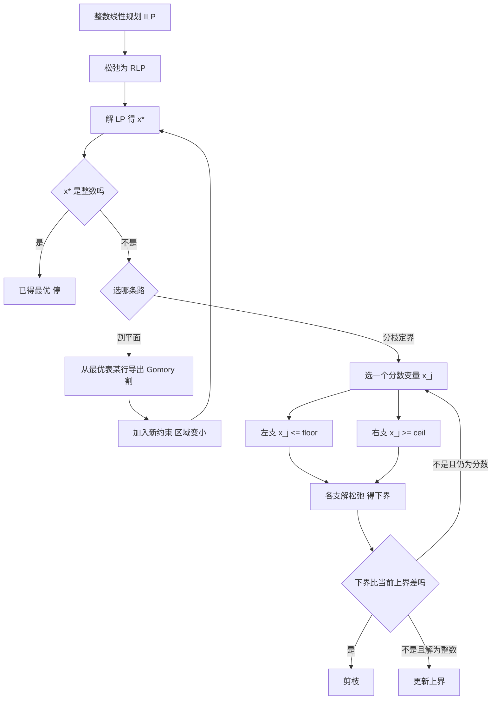

# 第 3 章：整数规划

- **难度**：★★★ | **预估学时**：5 小时 | **前置**：第 1 章（单纯形法、对偶）、第 2 章（全么模）

## 学习目标

学完本章，你能：

1. 分清纯整数规划、混合整数规划、0-1 规划，并写出它们的标准形式。
2. 说明为什么"把松弛问题的最优解四舍五入"通常得不到整数最优解，甚至可能不可行。
3. 从一张最优单纯形表导出一个 Gomory 割平面，并解释它为什么切掉了非整数解、留下了全部整数解。
4. 画出分枝定界树，说清"分枝""定界""剪枝"三件事各自在做什么。
5. 判断一个问题该用割平面、分枝定界，还是两者结合。

## 一句话核心

**整数规划难，不是难在"多了一个取整条件"，而是难在可行域从一整片连续区域缩成了散落的格点；割平面法用新约束把区域一点点削到只剩整数点，分枝定界法把区域一分为二、分别算松弛下界再剪枝——两条路都在做同一件事：让连续松弛的解离整数可行域越来越近。**

## 零基础讲解

### 概念 1：三种整数规划（难度：基础）

按变量取值分三类：

| 类型 | 变量要求 | 例子 |
|---|---|---|
| 纯整数规划 | 所有变量都取整 | 下料问题（每根钢管切几段） |
| 混合整数规划（MIP） | 只有部分变量取整 | 生产计划里"机器开几台"要整数，"原料用几吨"可连续 |
| 0-1 规划 | 变量只能取 0 或 1 | 指派问题、"建不建这个仓库" |

若目标与约束仍是线性的，就叫**整数线性规划**，本章讨论的 (ILP) 就是最简形式：

(ILP) min cᵀx　s.t. Ax = b，x ≥ 0 且 xᵢ 取整，i = 1,…,n

去掉取整要求得到的 (RLP) 叫它的**松弛**（relaxation）：

(RLP) min cᵀx　s.t. Ax = b，x ≥ 0

两者的约束函数完全一样，所以围出的**连续区域**也完全一样。区别只有一处：**(ILP) 的可行域是这片区域里散落的格点，(RLP) 的可行域是整片区域。**

这个区别带来三个必须记住的事实：

1. (ILP) 的可行域 ⊂ (RLP) 的可行域，所以 **(RLP) 的最优值是 (ILP) 最优值的下界**（对 min 问题）。
2. 可行解**数目**变少了，求解却**变难了**——因为连续方法（单纯形、内点）全部失效，它们只会往顶点上跑，而顶点往往不是格点。
3. **不存在通用的"取整"策略**。原因后面细讲。

### 概念 2：为什么不能直接取整（难度：基础）

书上例 3.1 就是为了打掉这个念头。设

min −30x₁ − 36x₂　s.t. x₁ + x₂ ≤ 6，5x₁ + 9x₂ ≤ 45，x₁,x₂ ≥ 0

松弛问题的最优解是 x = (9/4, 15/4) = (2.25, 3.75)，最优值 −405/2 = −202.5。

现在取整试试：

- 向下取整 (2, 3)：可行，值 −60 − 108 = −168。**离最优很远**。
- 四舍五入 (2, 4)：检验 2+4 = 6 ✓，但 5×2 + 9×4 = 46 > 45 ✗，**根本不可行**。
- 向上取整 (3, 4)：3+4 = 7 > 6 ✗，也不可行。

四舍五入撞上不可行，向下取整丢掉一大截——而真正的整数最优是 **(3, 3)，值 −198**，它在松弛最优解附近但不在任何"就近取整"的结果里。

结论：取整不是"微调"，它会把解踢出可行域或踢远。**整数规划的可行域形状和连续问题根本不同，必须换方法。**

### 概念 3：割平面法——用一刀把非整数点切掉（难度：高难）

思路：**在松弛问题里加一条新约束，这条约束满足两个条件——切掉当前的分数最优解，但不切掉任何一个整数可行解。** 反复切，直到最优解恰好是整数。

Gomory 割的推导，用一个具体表讲最清楚。把上面那个问题化成标准形（加 x₃、x₄）：

min −30x₁ − 36x₂　s.t. x₁ + x₂ + x₃ = 6，5x₁ + 9x₂ + x₄ = 45，x ≥ 0

单纯形算到最优，得到

x₁ + (9/4)x₃ − (1/4)x₄ = 9/4
x₂ − (5/4)x₃ + (1/4)x₄ = 15/4
目标值 −405/2

盯住第一行：x₁ 的值 9/4 不是整数，所以这行"碍事"。把它改写成"整数部分 + 分数部分"：

x₁ + 2x₃ − x₄ − 2 = 1/4 − (1/4)x₃ − (3/4)x₄

左边全是整数（x₁、x₃、x₄ 都是整数变量），所以左边是整数。右边必须也等于这个整数。而右边 = 1/4 − (1/4)x₃ − (3/4)x₄ ≤ 1/4 < 1（因为 x₃,x₄ ≥ 0）。一个整数既 ≤ 1/4 又……仔细看：左边 = 右边，右边 ≤ 1/4，整数 ≤ 1/4，那它只能 ≤ 0。于是

1/4 − (1/4)x₃ − (3/4)x₄ ≤ 0　⟺　x₃ + 3x₄ ≥ 1

这就是第一条割平面。它切掉了 (9/4, 15/4)（代入得 x₃ = x₄ = 0，左边 = 0 < 1，违反），但任何整数可行解都满足它（因为推导只用了"变量取整"这一条）。书上图 3.2 把它画成 4x₁ + 7x₂ ≤ 35，一眼能看出那条直线刚好从分数最优点和整数点之间穿过。

加入这条割后再解，得到新的分数最优解 (7/3, 11/3)，再切一刀得 2x₁ + 3x₂ ≤ 15，再解得 (3, 3, 0, 3, 8, 0)，全整数，停。最优值 **−198**。

割平面法的两个现实问题：

- **收敛慢**。每刀只切掉一点点，可能要切很多刀；如果总挑含 x₁ 的等式去构造（书里提到这种选法），过程会拖得更长。
- **数值不稳定**。系数越来越不整，浮点误差会积累。

所以现代求解器很少单用割平面，而是把它当"加强下界"的辅助手段，主力仍是分枝定界（这叫 branch-and-cut）。

### 概念 4：分枝定界法——把区域劈成两半（难度：进阶）

思想极朴素：松弛解 x* = (2.25, 3.75) 不是整数，那就说明"真正的整数解不可能同时满足 x₁ = 2.25"。于是任选一个分数分量，比如 x₁，把它劈成两支：

- 左支：加约束 **x₁ ≤ ⌊2.25⌋ = 2**
- 右支：加约束 **x₁ ≥ ⌈2.25⌉ = 3**

两个子问题的可行域合起来，刚好覆盖原问题所有整数可行解（因为整数 x₁ 只能 ≤2 或 ≥3），一个不漏；而分数点 x* 被排除在外。

"定界"指给每个子问题算松弛最优值，它就是这个分支里整数解的**下界**（min 问题）。如果某支的下界已经比当前找到的最好整数解（叫**上界**或 incumbent）还差，这一支不可能出更好的解，直接**剪枝**，不用再往下分。

三条剪枝规则：

1. **下界剪枝**：子问题松弛最优值 ≥ 当前上界 → 剪。
2. **整数剪枝**：子问题松弛最优解本身就是整数 → 它就是一个可行候选，用它更新上界，不再分枝。
3. **不可行剪枝**：子问题无可行解 → 剪。

用同一个例子走一遍（书上图 3.3 的树）：

**根节点**：LP 最优 (9/4, 15/4)，下界 −202.5，当前上界 +∞。x₁ = 2.25 是分数，分枝 x₁ ≤ 2 / x₁ ≥ 3。

**右支 x₁ ≥ 3**：LP 最优 **(3, 3)**，值 **−198**，恰好整数。→ 更新上界为 −198，这一支**停止分枝**（整数剪枝）。

**左支 x₁ ≤ 2**：LP 最优 (2, 35/9)，值 −200，仍是分数。下界 −200 < 上界 −198，还有希望，继续分枝 x₂ ≤ 3 / x₂ ≥ 4。

**左左支 (x₁≤2, x₂≤3)**：LP 最优 (2, 3)，值 **−168**。−168 > −198，比当前上界还差 → **下界剪枝**，这条分支不可能改进。

**左右支 (x₁≤2, x₂≥4)**：LP 最优 (9/5, 4)，值 **−198**。等于当前上界 → 即使有整数解也不会更好 → **下界剪枝**。

全部分支检查完，最优解 **(3, 3)**，最优值 **−198**。

**为什么这棵树这么浅**：因为第一次分枝就撞上了一个整数最优解，把上界压得很紧；后面两支的下界都不低于它，立刻被剪。如果换一个上界发现得晚的问题，树会大得多。

**代价**：分枝定界本质仍是**指数时间**——最坏情况下分枝数随变量个数指数增长。它之所以实用，是因为好的上界能让绝大多数分支被剪掉。求解器的差距，很大程度上就在"怎么选分枝变量、怎么先探索有希望的分支"。

历史小注：这个方法由 Land 和 Doig 在 1960 年提出，当时她们在伦敦政治经济学院，没有计算机，只能用两台手摇计算器算。

### 概念 5：建模时最值钱的几个 0-1 技巧（难度：进阶）

整数规划真正的门槛，常常不在算法，而在**怎么把现实规则写成线性约束**。四个常用套路：

- **互斥**：两件事不能同时做 → x₁ + x₂ ≤ 1。
- **依赖**：要做 A 必须先有 B → x_A ≤ x_B。
- **固定费用**：开厂要付 F，产量最多 M → 用 y ∈ {0,1} 表示开不开，约束 产量 ≤ M y，目标里加 F y。**大 M 法**就是这个原理。
- **至少选 k 个**：∑ xᵢ ≥ k。

这些约束都不是"线性等式/不等式"之外的东西，全靠 0-1 变量当开关。会了这套，很多看起来"没法用数学表达"的规则就能写进模型。

### 概念 6：三类问题的关系与选择（难度：进阶）

- **全么模的结构**（运输、指派）：整数约束自动满足，直接解 LP，不要上整数规划。
- **约束少、变量多、松弛紧**：分枝定界往往很快。
- **约束复杂、松弛松**：割平面能加强下界，配合分枝定界（branch-and-cut）最有效。
- **规模巨大、只要求近似**：第 5 章的近似算法与启发式更划算。

判断依据始终是一条：**松弛问题的最优值和整数最优值差多远**（这个差叫整数间隙，integrality gap）。差得小，分枝定界就快；差得大，再多技巧也难。

## 图示

**看图说明**：两条路都从"解松弛"出发，出口都是"解变整数"。差别在改区域的方式：割平面**削**，分枝定界**劈**。注意 N 这个剪枝框——它是分枝定界能跑得动的原因，没有剪枝就退化成穷举。

## 类比与实例

### 类比：在果冻里挑樱桃

把松弛可行域想成一块果冻，整数可行解是埋在里面的樱桃。连续方法只能找到果冻表面最靠边的那个点，而那个点往往没有樱桃。

- 割平面：拿刀贴着樱桃削掉一层果冻，每次削掉一块没有樱桃的部分。
- 分枝定界：把果冻切成两块，先看哪块"理论上可能藏着最甜的樱桃"（下界），甜度不够的整块扔掉。

类比失效处：果冻是三维的，实际可行域在几十维；"贴着樱桃削"在三维里靠眼睛，在高维里只能靠代数推导（就是那个整数/分数拆分）。

### 实例：两种方法在同一题上的对照

问题还是 min −30x₁ − 36x₂，s.t. x₁+x₂ ≤ 6，5x₁+9x₂ ≤ 45，x₁,x₂ 为非负整数。

| | 割平面法 | 分枝定界法 |
|---|---|---|
| 第 1 步 | LP 最优 (9/4, 15/4)，−202.5 | 同左 |
| 第 2 步 | 导出割 x₃+3x₄ ≥ 1，即 4x₁+7x₂ ≤ 35 | 分枝：x₁≤2 得 −200；x₁≥3 得整数 (3,3)，−198 |
| 第 3 步 | 新最优 (7/3, 11/3) | 左支再分：x₂≤3 得 −168 剪；x₂≥4 得 −198 剪 |
| 第 4 步 | 导出割 2x₁+3x₂ ≤ 15，新最优 (3,3) 整数 | 结束 |
| 结果 | (3,3)，−198 | (3,3)，−198 |

两条路给出同一个答案，这是必然的——它们找的都是"松弛可行域里的整数最优点"，只是策略不同。

**自己验一遍**：把 (3,3) 代回原约束：3+3 = 6 ✓，5×3 + 9×3 = 42 ≤ 45 ✓，值 −90 − 108 = −198。再把 (4,2) 试试：4+2 = 6 ✓，20+18 = 38 ≤ 45 ✓，值 −120 − 72 = −192，比 −198 差。(2,3) 得 −168。可见 (3,3) 确实最好。

## 常见误解

- **别以为整数规划 = 线性规划 + 取整。** 取整可能破坏可行性，也可能远离最优；两者是不同形状的可行域。
- **别以为"变量取整"让问题变简单。** 它让连续方法失效，问题从 P 类掉进 NP-难（第 5 章）。
- **别以为割平面越少越好。** 每一刀都在加强下界，切得好的刀能让分枝定界少走很多路；现代求解器的 branch-and-cut 就是两者合体。
- **别以为分枝定界一定能很快结束。** 它最坏是指数时间；快慢取决于上界发现得早不早、分枝变量选得好不好。
- **别以为"松弛最优值"就是答案的近似。** 它只是**界**，可能离整数最优很远；整数间隙大的时候，"接近松弛值"反而是个坏信号。

## 自测题

1. **（单选）**对 min 型整数规划，其线性松弛的最优值
   A. 一定等于整数最优值　B. 一定不大于整数最优值　C. 一定不小于整数最优值　D. 无法比较
   **答案：B**。解析：整数可行解是松弛可行解的子集，松弛问题在更大的集合上取最小，所以松弛最优值 ≤ 整数最优值（即它是下界）。

2. **（单选）**Gomory 割平面必须满足的两个条件是
   A. 切掉整数解、保留分数解　B. 切掉当前分数最优解、保留全部整数可行解　C. 只切掉一个点　D. 不改变可行域
   **答案：B**。解析：割的目的是让松弛解离开最优位置，同时不能误伤任何整数可行解，否则会把真正的最优解也切掉。

3. **（填空）**分枝定界中对分数变量 xⱼ = 2.25 分枝，两支的约束分别是 xⱼ ≤ ______ 和 xⱼ ≥ ______。
   **答案：2；3**。解析：整数只能落在 ≤⌊2.25⌋=2 或 ≥⌈2.25⌉=3 的区间里，两支合起来覆盖全部整数可能。

4. **（简答）**例 3.1 里，为什么"四舍五入 (2,4)"会不可行，而"向下取整 (2,3)"虽然可行却差得很远？
   **答案：** 松弛最优 (2.25, 3.75) 位于两条约束的交点附近，那里已经是可行域边界。把 x₂ 从 3.75 抬到 4 会越过 5x₁+9x₂ ≤ 45 这条边（46 > 45），可行性被破坏；把两个分量都往下压到 (2,3)，虽然回到了可行域内，但离边界很远，目标值从 −202.5 掉到 −168。取整既可能出界，也可能退到内部，两头都不讨好。

5. **（简答）**分枝定界里"上界"和"下界"分别指什么？为什么上界要用"已找到的最好整数解"而不是松弛值？
   **答案：** 下界是某分支松弛问题的最优值（min 问题里它是该分支整数解的最好可能值）；上界是已经找到的真实整数可行解的目标值。上界必须是**真实可行**的解才算数，松弛解可能根本不是整数，用它当上界会把还没探索的分支误剪掉。

## 复习锚点

- ILP 与 RLP 只差"取整"，可行域一个散、一个整片；松弛值是最优值的下界。
- 取整不可靠：可能不可行，也可能远离最优。
- 割平面：从最优表的一行拆成整数部分与分数部分，得到一条"切分数、留整数"的约束。
- 分枝定界三件事：分枝（劈区域）、定界（算松弛下界）、剪枝（下界差、已整数、不可行）。
- 决定难度的是**整数间隙**，不是变量多少。
