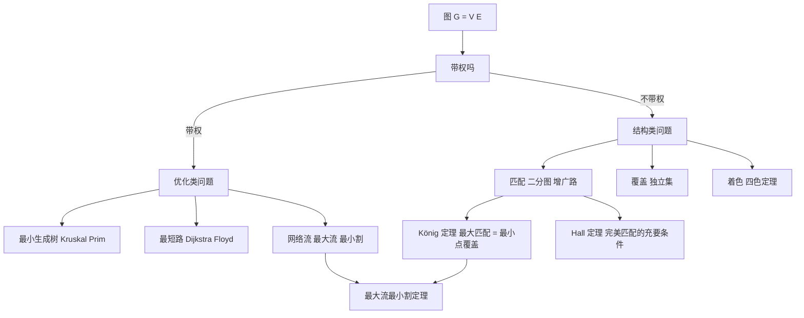

# 第 4 章：图与网络优化

- **难度**：★★★ | **预估学时**：7 小时 | **前置**：第 1 章（线性规划、对偶）、第 3 章（整数规划）

## 学习目标

学完本章，你能：

1. 用"顶点—边"的模型描述现实中的路网、电网、社交网络，并分清邻接、度、路径、连通、树这些基本概念。
2. 说清匹配、覆盖、着色、独立集四类问题的关系，并解释 König 定理为什么把"最大匹配"变成"最小点覆盖"。
3. 手工跑 Kruskal 和 Dijkstra，各写出每一步选了哪条边、更新了哪个距离。
4. 写出最大流模型，用"最大流最小割"定理判断一个流是否已经最优。
5. 认出对偶在原问题里的样子：最短路问题的对偶就是"势"，最大流的对偶就是最小割。

## 一句话核心

**图把"位置"和"连接"分开：只关心谁和谁连着，不关心距离多少。一旦这样抽象，选址、排课、送货、布线这些看起来毫不相干的问题，就都变成了同一类问题——在点与边的集合上做选择，而选择的最优性往往由一条漂亮的定理保证。**

## 零基础讲解

### 概念 1：图是什么，为什么值得单独学（难度：基础）

图 G = (V, E)：V 是**顶点**集合，E 是**边**集合，一条边连接两个顶点。带数字的边叫**带权图**，那个数字叫**权**（距离、费用、容量）。

几个必须一次记住的词：

| 词 | 白话 |
|---|---|
| 度 | 一个顶点连出的边的条数 |
| 路径 | 一串首尾相接的边 |
| 连通 | 任意两点之间都有路径 |
| 圈 | 起点和终点重合的路径 |
| 树 | 连通且没有圈的图（n 个点恰好 n−1 条边） |
| 二分图 | 顶点能分成两队，边只跨队、队内无边 |

为什么图值得单开一章？因为很多现实约束**天然是"连接关系"**：一条街道只能连通两个路口，一台机器一个时段只能干一件活，一个仓库只能服务有限的客户。把这些关系画成图，问题的结构就露出来了，而结构决定算法。

### 概念 2：匹配——两两配对，尽量多（难度：进阶）

**匹配**是一堆互不共点的边：每个顶点最多被配一次。**最大匹配**就是边数最多的那种配法。

生活原型：相亲配对、学生分宿舍、司机分车。若图是二分图（左边男生、右边女生），最大匹配就是"最多能成多少对"。

**Berge 定理**：一个匹配是最大匹配，当且仅当**不存在增广路**。增广路是一条起点终点都"没配上"的交替路径（未配边、已配边交替出现）。沿着增广路把匹配状态翻转（配的变不配、不配的变配），匹配数就 +1。这条定理是所有匹配算法的引擎：**不断找增广路，找不到就说明已经最大。**

二分图上找增广路可以用"交替 BFS/DFS"，复杂度 O(VE)。一般图（非二分）的匹配要难得多，Edmonds 1965 年的**花算法**（blossom algorithm）才把它做到多项式时间——难点在于奇圈会让"交替"判断出错，必须把奇圈缩成一个"花"再处理。

**König 定理**（二分图）：**最大匹配的边数 = 最小点覆盖的点数**。点覆盖是一堆顶点，使得每条边至少有一个端点被选中。这条等式很反直觉——一个是"边"，一个是"点"，数值却相等；它其实是"最大流最小割"在二分图上的特例（把匹配问题化成网络流就看得出来）。

**Hall 婚配定理**：二分图存在**完美匹配**（所有人都配上）的充要条件是，对左边任意一个子集 S，它连出去的邻居集合 N(S) 满足 |N(S)| ≥ |S|。白话：**任何一群人，他们认识的人总数不能比这群人少**。这是"资源不足"的精确数学表达。

### 概念 3：覆盖、独立集、着色（难度：进阶）

- **点覆盖**：选一些顶点，让每条边至少有一个端点在里面。
- **独立集**：选一些顶点，两两之间没有边。注意：独立集的补集一定是点覆盖，反之亦然——所以"最大独立集"和"最小点覆盖"是同一个数的两面。
- **边覆盖**：选一些边，让每个顶点至少被一条边碰到。
- **着色**：给顶点涂色，相邻顶点颜色不同。最少需要几种颜色，叫**色数**。

着色是最有名的图论问题：**四色定理**说平面地图只用四种颜色就够。它在 1852 年被提出，直到 1976 年才由 Appel 和 Haken 用计算机验证大量不可避免构型后证明——第一个被计算机证明的重要定理，当时引发过"计算机证明算不算证明"的争论。

实际用途：排课表（同一老师不能同时上两门）、频率分配（相邻基站不能用同一频段）、寄存器分配（同时活跃的变量不能共用一个寄存器）。

### 概念 4：最小生成树——把所有点连起来，最省（难度：基础）

n 个城市都要通电，架哪些电线最省钱？这就是**最小生成树**（MST）：在连通带权图里选 n−1 条边，连通所有点，总权最小。

两个经典算法，思路不同但都对：

- **Kruskal**：把所有边按权从小到大排序，依次考虑；只要这条边连接的两个点还不在同一个连通块里，就选它。用并查集判断。
- **Prim**：从一个点开始，每次从"已在树内的点"连到"树外的点"的边里挑最短的，加进来。

两个都是**贪心**，而且贪心在这里是对的——原因是一条叫"割性质"的定理：对任意一个把顶点分成两半的割，横跨割的最短边一定属于某棵最小生成树。Kruskal 每次都在验证这个性质。

为什么贪心在 MST 上成立、在别的问题上不成立？关键在于 MST 有**拟阵**结构：可行边集构成一个拟阵，而拟阵上的贪心必然最优。这一条在第 5 章讲近似算法时会再提到，它是"什么时候能贪心"的分界线。

### 概念 5：最短路——从一点到另一点，最快（难度：基础）

**单源最短路**：给定起点 s，求到每个点的最短距离。

- **Dijkstra**：把点分成"已确定"和"未确定"，每次从未确定里取距离最小的点，用它去更新邻居。前提：**边权非负**。为什么必须非负？因为 Dijkstra 的"确定即最终"依赖一个假设：绕远路只会更远。有负边时这个假设破了，得改用 Bellman–Ford 或 SPFA。
- **Floyd**：三重循环，求**所有点对**之间的最短路。核心是一个递推：d[i][j] = min(d[i][j], d[i][k] + d[k][j])——"允许经过前 k 个点"时的最短距离。O(n³)，n 小于几百时好用。

短路的用处远不止导航：项目排期里的关键路径、电路延迟分析、套利检测（取对数后用负权找负圈）都是它。

### 概念 6：网络流——把"能送多少"算清楚（难度：高难）

给一个有向图，每条边有**容量** c(u,v)，一个源点 s、一个汇点 t。**流** f 满足两条规矩：

1. **容量限制**：0 ≤ f(u,v) ≤ c(u,v)。
2. **流量守恒**：除 s、t 外，每个点"流入 = 流出"。

**最大流**就是让从 s 到 t 的总流量最大。

**最小割**：把点集分成 S（含 s）和 T（含 t），割的容量是所有从 S 指向 T 的边的容量之和。

**最大流最小割定理**（Ford–Fulkerson，1956）：**最大流的值 = 最小割的容量。** 这一条把"优化问题"和"证明"绑在一起：

- 上界：任何流都不可能超过任何割（流量必须穿过割，而割的边容量有限）。
- 达到：当残余网络里再也找不到 s→t 的增广路时，把"能从 s 到达的点"记为 S，剩下的记为 T，这个割的每条边都满了、每条反向边都空了，于是流量 = 割容量。

**Ford–Fulkerson 算法**：反复在**残余网络**里找增广路（残余容量 = 容量 − 当前流，反向边容量 = 当前流），找到就沿路推流，找不到就停。残余网络里的反向边是关键设计——它允许"反悔"：先前送错方向的流可以退回来。

两个实践问题：边权是整数时 FF 一定终止，但最坏可能很慢（每次只增 1）；**Edmonds–Karp** 改成每次找**最短**增广路（BFS），复杂度 O(VE²)，就稳了。

**最小费用最大流**：在"流量最大"的前提下让总费用最小。做法是把"找增广路"从 BFS 换成"按费用做最短路"（用 SPFA 或势函数 + Dijkstra），沿最便宜的增广路推流。这一类模型在物流、任务分配里极其常见。

## 图示

**看图说明**：中间那个岔口"带权吗"决定了你走优化路线还是结构路线。注意最下面两条箭头汇到"最大流最小割定理"——König 定理和它其实是同一件事的两个特例，这也是本章与第 1 章对偶理论的接口。

## 类比与实例

### 类比：地铁线路图

地铁图只画站和线，不按真实比例——这正是"图抽象"的样子。你要从 A 站到 B 站，关心的是"换几次线、坐几站"，不是"直线距离多少"。最小生成树像"要保证所有站互通，最少修几条轨道"；最短路像"最快到达"；网络流像"早高峰每小时最多能运多少人"。

类比失效处：地铁有换乘代价、有单向限流、有站点容量，模型里这些都要额外加约束，图本身不自动包含。

### 实例 1：Kruskal 与 Dijkstra 在同一个图上跑

六个点 A–F，边与权：

| 边 | 权 |
|---|---|
| A–B | 4 |
| A–C | 2 |
| B–C | 1 |
| B–D | 5 |
| C–D | 8 |
| C–E | 10 |
| D–E | 2 |
| D–F | 6 |
| E–F | 3 |

**Kruskal**（按权从小到大）：

1. B–C（1）→ 选。连通块 {B,C}。
2. A–C（2）→ 选。连通块 {A,B,C}。
3. D–E（2）→ 选。连通块 {D,E}。
4. E–F（3）→ 选。连通块 {D,E,F}。
5. A–B（4）→ A、B 已在同一块，**丢弃**（会成圈）。
6. B–D（5）→ 选。两块合并成 {A,B,C,D,E,F}。

已选 5 条边（n−1 = 5），结束。**总权 = 1+2+2+3+5 = 13。**

**Dijkstra 从 A 出发**（初始 d(A)=0，其余 ∞）：

| 步 | 确定点 | 更新后的距离 |
|---|---|---|
| 1 | A（0） | C=2，B=4 |
| 2 | C（2） | B 改为 3（经 C 更近），D=10，E=12 |
| 3 | B（3） | D 改为 8（3+5），其余不变 |
| 4 | D（8） | E 改为 10（8+2），F=14 |
| 5 | E（10） | F 改为 13（10+3） |

最终距离：A=0，C=2，B=3，D=8，E=10，F=13。**A 到 F 最短 13，路线 A–C–B–D–E–F。**

**注意两处的差别**：MST 的总权 13 与 A 到 F 的最短路 13 数值相同，纯属巧合——它们回答的是不同问题（"连通全部点最省" vs "两点之间最快"）。别把这两个 13 混成一件事。

### 实例 2：一个最大流问题

源点 s，汇点 t，边与容量：s→a(3)、s→b(2)、a→c(2)、b→c(3)、c→t(4)。

**先猜一个流**：s→a 送 3、s→b 送 2（源点总共送出 5）。但 a 只能往下送 2（a→c 容量 2），b 送 2。汇到 c 的是 4，c→t 容量正好 4。可行流为 4。

**再用割验证最优性**：取 S = {s,a,b,c}，T = {t}，割就是 c→t，容量 4。任何流都不可能超过 4。既然已经达到 4，它就是**最大流**。

**再看一个更小的割**：S = {s}，割是 s→a + s→b = 5。这个割容量更大，所以不是最小割。最小割 = 4 = 最大流，定理成立。

**残余网络视角**：此时的残余容量里，s→a 剩 0、s→b 剩 0、a→c 剩 0、b→c 剩 1、c→t 剩 0，再加反向边 a→s(3)、b→s(2)、c→a(2)、c→b(2)、t→c(4)。从 s 出发只能走到 s 自己，**没有 s→t 的增广路**，算法停，结论正确。

## 常见误解

- **别以为最大匹配就是"贪心地配能配的"。** 贪心会配错（先配了一条边，堵死了后面两条）。增广路的意义就是纠错。
- **别以为 Dijkstra 什么图都能用。** 有负权边时它会把"绕远反而更近"的情况漏掉，结论直接错。
- **别以为最小生成树唯一。** 权值有并列时可能有多棵不同的 MST，但总权相同。
- **别以为最大流的答案是"源点出边的容量之和"。** 那只是上界，瓶颈常在中间；最小割就是"最窄的那道口"。
- **别以为四色定理跟算法无关。** 求任意图的最小着色是 NP-难的（第 5 章），四色定理只是说**平面图**的上界是 4，不给你快速找到着色的办法。

## 自测题

1. **（单选）**一个连通图有 n 个顶点，它的任一棵生成树有多少条边？
   A. n　B. n−1　C. n+1　D. 取决于权
   **答案：B**。解析：树连通且无圈，从任一点出发每次加一条边连一个新点，恰好加 n−1 次。

2. **（单选）**Berge 定理说的是
   A. 匹配最大 ⟺ 无增广路　B. 匹配最大 ⟺ 点数最多　C. 最大匹配 = 最小点覆盖（对所有图）　D. 匹配必唯一
   **答案：A**。解析：C 只对二分图成立（König 定理），一般图不成立；A 是对所有图都成立的判别准则。

3. **（填空）**最大流最小割定理指出，网络中从 s 到 t 的最大流量等于______的容量。
   **答案：最小割**。解析：任何流受任何割限制，而算法停止时的残余网络恰好给出一个"满割"，两者相等。

4. **（简答）**为什么 Dijkstra 要求边权非负？举一个负权会让它出错的例子。
   **答案：** Dijkstra 每次把"当前距离最小"的点标记为最终确定，这一步默认"以后不可能有更短的路径绕到它"。有负权时这个默认被打破：例如 A→B 权 1、A→C 权 5、C→B 权 −10，A 到 B 真实最短是 −5（走 A→C→B），但 Dijkstra 会先确定 B=1 并锁死，之后再也不会更新它。

5. **（简答）**网络流算法里为什么要引入"反向边"？
   **答案：** 为了让算法能反悔。沿增广路推流时可能占用了某条本应留给其他路径的容量；反向边提供"把已送的流退回去"的能力，使后续增广路可以改道。没有反向边，Ford–Fulkerson 会卡在次优解上。

## 复习锚点

- 图 = 点 + 边；树 = 连通无圈，n 点 n−1 边。
- 匹配靠增广路改进；二分图上最大匹配 = 最小点覆盖（König）。
- MST 贪心可行的根源是割性质（拟阵）；最短路 Dijkstra 要求非负权。
- 最大流 = 最小割，残余网络 + 反向边是算法的心脏。
- 覆盖、独立集、着色是同一族结构问题的不同切面，求最小着色是 NP-难的。
