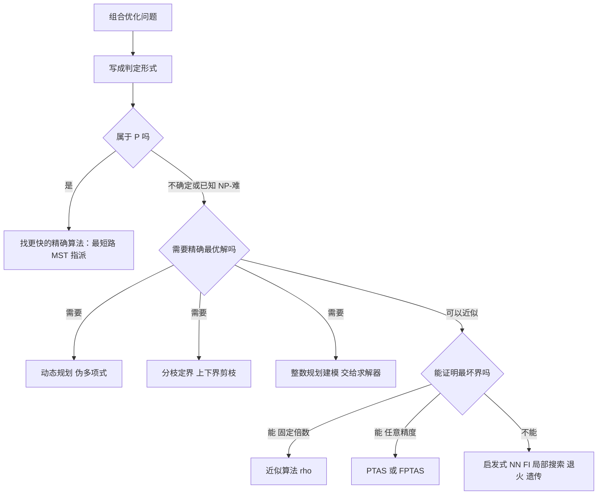

# 第 5 章：组合优化

- **难度**：★★★ | **预估学时**：7 小时 | **前置**：第 1~4 章（线性规划、整数规划、图与网络）

## 学习目标

学完本章，你能：

1. 判断一个问题是"组合优化"还是"连续优化"，并说出它的判定形式。
2. 分清 P、NP、NP-完全、NP-难四个类，说清"归约"的方向为什么不能反。
3. 用"先证属于 NP，再把一个已知 NP-完全问题归约过来"的套路，判断一个新问题的难度。
4. 解释近似算法的"最坏情况界 ρ"是什么意思，并手算一个贪心算法的失败例子。
5. 分清近似算法、近似方案（PTAS/FPTAS）、启发式算法三者的差别，知道各自能承诺什么。

## 一句话核心

**组合优化研究的是"在有限但爆炸多的方案里挑最好的"。它的分水岭是一条：如果问题属于 P，就去找更快的精确算法；如果属于 NP-难，就别再指望精确求解，转而去争取"有界近似"或"实践有效"——先认清难度，再决定策略。**

## 零基础讲解

### 概念 1：什么叫组合优化（难度：基础）

组合优化的一般形式：

min f(x)　s.t. x ∈ F

F 是一个**有限的离散集合**（可行组合的集合）。和前面几章的区别只有一条：F 不是一片连续区域，而是一堆散落的方案。

四个代表问题，认脸就行：

| 问题 | 一句话 | 方案数 |
|---|---|---|
| 0-1 背包 | 容量 C，n 件物品各有重量 wᵢ 和价值 pᵢ，装哪些使价值最大 | 2ⁿ |
| 旅行售货商（TSP） | 走遍 n 个城市各一次回到出发地，路程最短 | (n−1)!/2 |
| 装箱 | 若干物品装进最少的箱子 | 与箱子数成阶乘级 |
| 排序（调度） | n 个工件在 m 台机器上加工，使完工时间最短 | 组合数增长极快 |

**组合爆炸**不是修辞。n = 50 的背包有 2⁵⁰ ≈ 10¹⁵ 种方案，每秒检查一亿个也要跑几个月；n = 20 的 TSP 有约 6×10¹⁶ 条路线。这就是为什么"聪明地搜索"比"更快地计算"更重要。

每个组合优化问题都有两种形态：

- **最优化形式**：min f(x)，要具体的最优方案。
- **判定形式**：给定阈值 K，问"是否存在可行 x 使 f(x) ≤ K"。复杂性理论只讨论判定形式，因为"是/否"的答案容易比较、容易归约。

### 概念 2：复杂性类，四个盒子（难度：进阶）

- **P**：存在多项式时间算法能**解出**的问题类。"解出"意味着给出答案。
- **NP**：给定一个候选解（叫**证书**），能在多项式时间内**验证**它对不对的问题类。注意 NP 不表示"非多项式"，它表示"可验证"。
- **NP-完全（NP-C）**：A 属于 NP，且**所有** NP 问题都能多项式归约到 A。它是 NP 里"最难"的那一层。
- **NP-难（NP-hard）**：所有 NP 问题都能归约到它，但它自己**不一定**属于 NP。优化问题（要最优值而非是/否）通常落在这一层。

包含关系：P ⊆ NP；若 P = NP（未解决的世纪难题），四个盒子会塌成两个。

**归约**（reduction）的定义要抠准：A ≤p B 意思是"存在一个多项式时间的变换，把 A 的任意实例变成 B 的实例，且两者答案一致"。它的方向是**从 A 到 B**：把 A 的难度"推给" B。所以若 B 有快速算法，A 也有了；若 A 很难，B 也难。**方向弄反是最常见的错误。**

归约具有传递性：A ≤p B、B ≤p C 则 A ≤p C。这条性质让 NP-完全性可以"接力"证明。

**证明一个问题是 NP-完全的套路**（两步，缺一不可）：

1. **A ∈ NP**：给出证书形式，并说明能在多项式时间内验证。
2. **某个已知 NP-完全问题 ≤p A**：构造多项式变换，并证明"是"与"否"的答案都对应得上。

历史上第一块基石是 Cook（1971）证明**布尔可满足性（SAT）**是 NP-完全的；随后 Karp（1972）列了 21 个 NP-完全问题，把这张网铺开。今天已知的 NP-完全问题有几千个，覆盖排课、装箱、图着色、集合覆盖、旅行售货商等等。

### 概念 3：问题难不难，先看它长什么样（难度：进阶）

同一个"味道"的问题，可能一个在 P、一个在 NP-C。举两组对照：

- **最短路径 vs 最长路径**：前者多项式（Dijkstra），后者 NP-难（它包含 Hamilton 路问题）。
- **2-着色判定 vs 3-着色判定**：二分图能否 2-着色是多项式（判奇圈）；一般图能否 3-着色是 NP-完全。
- **指派问题 vs 三维指派问题**：二维有全么模结构，多项式（匈牙利算法）；三维一下丢掉全么模，变成 NP-难。
- **子集和 vs 超增子集和**：一般的子集和（给一堆数和一个目标，问能否凑出）是 NP-完全的；但如果这堆数满足"每个数都大于前面所有数之和"（超增），就有多项式算法。

超增子集和的算法极简单：从最大的数往回扫，能减就减，最后看能不能减到 0。

t = B；对 j = n 到 1：若 t ≥ aⱼ，则 t = t − aⱼ；最后 t = 0 就是"是"。

为什么这对超增有效？因为每个数比前面所有数的总和还大，所以"要不要选它"没有回旋余地——不选它，后面的数加起来也补不上这个缺口。**结构一变，难度天差地别**，这条观察是组合优化里最实用的直觉之一。

顺带一句：超增子集和被 Merkle 和 Hellman 用来做过公钥密码（背包密码），加密就是把明文位串映射成超增集合的和，再乘一个模数伪装。它后来被 Shamir 攻破，是"NP-难问题也能被利用、但不保证安全"的经典案例。

### 概念 4：已知 NP-难，还想求精确解怎么办（难度：进阶）

三条路，都能给出**真正的最优解**，代价是时间不保证多项式：

**（1）动态规划**。把问题拆成"规模小一点的同类问题"，写出递推。背包的递推：

F_k(c) = max{ F_{k−1}(c)，F_{k−1}(c − w_k) + p_k }　（放不下第 k 件时只取前项）

F_k(c) 表示"只看前 k 件、容量 c 时的最大价值"。复杂度 O(nC)——注意 C 是**容量数值**，不是输入长度，所以这是**伪多项式时间**：C 写成二进制只有 log C 位，但算法要跑 C 步。容量一大就失效。

**（2）分枝定界**。思路和第 3 章一样，只是界要好算：

- **上界**：把物品按"价值密度"（pᵢ/wᵢ）从大到小排序，能装就装，装不下就按比例"切一半"装进去（这叫**线性松弛**），得到的值一定比真实最优高。
- **下界**：同样的排序，装不下就跳过、继续看后面的（只装整件），得到的值一定可行。
- 上下界一夹，差距小的分支直接剪掉。

**（3）整数规划建模**。把组合问题写成 0-1 规划，交给求解器。TSP 的标准模型要加"子圈消除约束"（每个真子集至少有一条边连出去），否则解出来可能是一堆互不相连的小圈——这是组合问题建模时最常见的坑。

### 概念 5：近似算法——退一步，但要有保证（难度：高难）

**最坏情况界**（worst-case ratio）ρ_A 的定义：对问题的**所有**实例 I，

C_A(I) / C*(I) ≤ ρ_A　（最小化问题，C_A 是算法解，C* 是最优值）

它承诺的是"再差也差不过 ρ 倍"，而不是"平均很好"。这个承诺很硬，也正因为硬，能证明的问题不多。

**背包：一个贪心的失败例子**。容量 10，三件物品：

| 物品 | 重量 | 价值 | 价值密度 |
|---|---|---|---|
| A | 6 | 7 | 1.17 |
| B | 5 | 5 | 1.00 |
| C | 5 | 5 | 1.00 |

按密度贪心：先装 A（重 6，值 7），剩余容量 4，B、C 都装不下，得 7。
最优：装 B + C，重量 10，价值 **10**。
比值 10/7 ≈ 1.43——贪心确实错，但错得不算离谱。

书上的 **GK 算法**就是"按密度贪心"，再和"只装价值最大的单件物品"复合，取两者较好（**CK 算法**），可以证明最坏情况界 **ρ = 2**（定理 5.5）。也就是说：**不管数据多刁钻，它给出的解至少是最优的一半。**

**TSP：MST 双树法也是 2-近似**（定理 5.7）。做法：求最小生成树，把每条边走两遍（得到一个 Euler 环游），再"抄近路"跳过重复访问的城市（三角不等式保证不会变长）。因为最优环游去掉一条边就是一棵生成树，所以 MST ≤ OPT；双树长 2·MST ≤ 2·OPT，抄近路只会更短。**界是 2，且这个界是紧的**（存在实例刚好达到 2 倍）。

读这些证明时抓住一个套路：**先找一个"最优解的一部分"作为下界（MST、线性松弛），再看算法解不超过这个下界的几倍。** 界就是这么来的。

### 概念 6：近似方案 PTAS 与 FPTAS（难度：高难）

近似算法给的是固定倍数 ρ；**近似方案**给的是"你指定精度 ε，我按 ε 调算法"：

- **PTAS**（多项式时间近似方案）：对任意 ε > 0，能在**关于 n 的多项式时间**内给出 (1+ε) 近似解，但时间可以是 n^{1/ε} 这种"多项式但指数很大"的形式。
- **FPTAS**（完全多项式时间近似方案）：时间同时是 n 和 1/ε 的多项式。这是组合优化里最强的近似承诺。

**背包的 PTAS（PKP_ε）**：令 k = ⌈2/ε⌉。枚举所有"不超过 k 件"的子集（共 O(n^k) 种），对每种剩下的容量按密度贪心填满，取最好的。因为最优解里"装不进去"的部分最多影响有限，误差被控制在 ε 内。

**背包的 FPTAS**：先做**价值缩放**——把每个 pᵢ 改成 p̃ᵢ = ⌊pᵢ / (ε P / n)⌋（P 是价值上界），把"数值"压小；在这个缩微实例上跑 O(n²/ε) 的动态规划；再把解映射回原问题。误差来自舍入，累计不超过 εP。**这一步的巧妙之处在于：伪多项式算法的瓶颈是"数值大"，那就把数值改小。**

注意：**不是所有 NP-难问题都有 PTAS**（除非 P = NP）。装箱问题连 PTAS 都没有（除非 P = NP），这类问题只能做"渐进近似比"或"绝对近似比"。这句话在看论文时经常被搞混。

**再补一个概念：强 NP-完全**。定义 5.5 说，若 Π 是 NP-完全问题，且存在多项式函数 p 使得 Π 的**所有**实例 I 都满足"最大数 B(I) ≤ p(规模 x(I))"，则称 Π 为**强 NP-完全**问题。说白了：**强 NP-完全问题的数值不会比规模大太多**。

定理 5.2：在 P ≠ NP 的前提下，**强 NP-完全问题不存在伪多项式时间算法**。

这条定理给了一个实用的分界线：

- 背包、子集和是**一般意义**的 NP-完全问题（数值可以任意大，所以有伪多项式 DP）；
- TSP、装箱、图着色是**强 NP-完全**问题（数值被规模限制，伪多项式这条路被堵死）。

所以看到"这个问题有 O(nC) 的 DP"时，先问一句：C 能不能任意大？能，它就是一般 NP-完全；不能，它可能是强 NP-完全，DP 那条路走不通。

### 概念 7：启发式——没有保证，但真能用（难度：进阶）

**启发式算法**（heuristic，源自希腊语"发现"）不承诺最坏界，只求在合理时间内给出足够好的解。它的适用场景很明确：

- 问题连近似算法都设计不出来（比如装箱）；
- 数据本身就不精确（风速、路况、人流都是估的），苛求最优没意义；
- 规模太大，精确算法跑不动。

几个典型：

- **最近邻法（NN）**：TSP 里每次走向最近的未访问城市。实现简单，平均不错，最坏可以很差。
- **最远插入法（FI）**：先把最远的点连起来，再逐步把"插入代价最大"的点插进当前路线。书上给的 TSPLIB 实测：FI 平均比值约 **1.16**（很接近最优），但**理论上界超过 2**，甚至有实例说明它比 NN 更差。**平均表现与最坏界经常不一致**，这是启发式研究的核心张力。
- **局部搜索与 2-opt**：拿一个可行解，反复试"交换两条边""反转一段路线"，只要变好就接受。TSP 里 2-opt 就是把两条交叉的边换成不交叉的两条。
- **模拟退火**：允许以一定概率接受变差的解，概率随"温度"下降而变小，用来跳出局部最优。
- **遗传算法、禁忌搜索、蚁群算法**：分别用"种群交叉变异""记忆禁用表""信息素正反馈"来维持搜索多样性。

评价启发式必须说清两件事：**在什么数据上测的**、**和什么比**。只说"效果很好"没有意义。

## 图示

**看图说明**：这张图是一条决策链，每一步都在"降要求"。注意最右边的分支——启发式不是"没办法的选择"，而是在"数据本身不精确"时更合理的选择。

## 类比与实例

### 类比：在一座巨大的仓库里找最便宜的货

- **P 类问题**：仓库有索引，顺着目录走就能找到。
- **NP 类问题**：没有索引，但只要有人给你一个货号，你能很快核对它是不是最便宜的。
- **NP-完全问题**：所有没索引的仓库，本质上都是同一座仓库换了个门牌。
- **近似算法**：不找最便宜的，但保证找到的不比最便宜的贵一倍以上。
- **启发式**：凭经验先摸几排货架，好不好看运气，但时间可控。

类比失效处：仓库有物理空间，"摸几排"能靠直觉；组合问题的搜索空间没有直觉可用，全靠设计。

### 实例 1：背包的贪心为什么错，差多少

前面那个例子（容量 10、A 重 6 值 7、B 与 C 各重 5 值 5）：贪心 7，最优 10。再把这个例子推广：如果有一件"密度略高但很占地方"的物品，加上一堆"密度略低但刚好填满"的物品，贪心就会锁死在一个次优解里。

**关键观察**：贪心错的原因是"密度"这个指标只考虑单位重量的价值，**不考虑剩余空间能不能被填满**。任何贪心的失效，几乎都能归结为"局部指标没编码全局约束"。

### 实例 2：一个 TSP 的 2-近似为什么成立

设最优环游长度 OPT。把环游上任意一条边删掉，得到一棵生成树，所以 **MST ≤ OPT**。

MST 每条边走两遍，得到一个经过所有点、回到起点的闭合游走，长度 **2·MST ≤ 2·OPT**。

把这个闭合游走"抄近路"：每当要重复访问一个已经到过的城市，就直接跳到下一个没去过的城市。由三角不等式（两点间直达不比绕路长），长度只会变短。于是

算法解 ≤ 2·MST ≤ 2·OPT

界是 2。**为什么不能再小**：书上的图 5.22 构造了一类实例，MST 很长而最优环游很短，比值逼近 2。所以 2 是这类算法的天花板，不是证明偷懒。

### 实例 3：超增子集和怎么解出一段明文

书上例 5.3：超增集合 S = {2, 5, 9, 21, 45, 203, 215, 450, 946}，取模数 p = 2003、乘数 u = 1289，把明文 101100111 加密成公开集合

C = {575, 436, 1586, 1030, 1921, 569, 721, 1183, 1570}

乙拿到 p、u、C 后，先算出原超增集合下对应的和 Y = 1643，再用 RS 算法从和反推明文。

**从 1643 倒推，逐个数判断减不减**：

| 当前 t | aⱼ | 减？ | 之后 |
|---|---|---|---|
| 1643 | 946 | 减 | 697 |
| 697 | 450 | 减 | 247 |
| 247 | 215 | 减 | 32 |
| 32 | 203 | 不减 | 32 |
| 32 | 45 | 不减 | 32 |
| 32 | 21 | 减 | 11 |
| 11 | 9 | 减 | 2 |
| 2 | 5 | 不减 | 2 |
| 2 | 2 | 减 | 0 |

最后 t = 0，解的位串是 **1 0 1 1 0 0 1 1 1 = 101100111**，和明文一致。

**核对一遍**：被选中的元素是 2、9、21、215、450、946，加起来 2+9+21+215+450+946 = 1643 ✓；位串对应位置是第 1、3、4、7、8、9 位为 1，正好是 101100111 ✓。

**这个例子说明三点**：

1. 同样的"凑数"问题，换成超增结构后，倒推是**唯一路径**，不用搜索。
2. 加密后的集合 C 表面上完全看不出结构，只有知道 p、u 的人能还原成 S。这就是背包密码的思路——**用"结构"当密钥，用"无结构"当密文**。
3. 它后来被 Shamir 用"解的格子结构 + 整数规划"攻破了。设计密码时，"求解难"不等于"安全"，这是密码学里反复出现的教训。

## 常见误解

- **别以为 NP 是"非多项式"。** NP 是"可验证"，P ⊆ NP。真正未知的是 P 是否等于 NP。
- **别以为"归约"可以反着用。** A ≤p B 证明的是"B 至少和 A 一样难"，不能推出"B 能解则 A 也能解"的反向结论。
- **别以为动态规划是多项式算法。** 背包 DP 的 O(nC) 里 C 是数值，容量写成十进制 1000000 时它就跑不动，这叫伪多项式。
- **别以为近似算法的 ρ 是"平均误差"。** 它是对所有实例的最坏承诺；平均表现可能远好于 ρ。
- **别以为"启发式"就是"随便凑"。** 好的启发式有明确的邻域结构、接受准则和参数设定，评价它必须给出测试集与对照基线。
- **别以为 NP-难就不能精确求解。** 小规模实例、特殊结构（全么模、超增、树形）常常可以精确求解，难度是"一般情况"的性质。

## 自测题

1. **（单选）**下列关于 P 与 NP 的说法，正确的是
   A. NP 问题一定不能在多项式时间内求解　B. P ⊆ NP　C. NP-完全问题一定属于 P　D. NP-难问题一定属于 NP
   **答案：B**。解析：能在多项式时间解出的问题，当然也能在多项式时间验证一个给定解，所以 P ⊆ NP。

2. **（单选）**要证明问题 A 是 NP-完全的，必须做的是
   A. 证明 A ∈ P　B. 证明 A ∈ NP，并把一个已知 NP-完全问题归约到 A　C. 把 A 归约到一个已知 NP-完全问题　D. 证明 A 无多项式算法
   **答案：B**。解析：方向必须是从已知难问题**归约到** A（说明 A 至少一样难），反向归约只能说明 A 不比它难，证明不了完全性。

3. **（填空）**背包问题的动态规划复杂度 O(nC)，其中 C 是容量的______，因此它被称为______多项式时间算法。
   **答案：数值（大小）；伪**。解析：输入长度是 log C 位，算法却要跑 C 步，对输入长度是指数的。

4. **（简答）**容量 10、物品 A(6,7)、B(5,5)、C(5,5)，按价值密度贪心得到的解和最优解各是多少？比值多少？
   **答案：**贪心先取 A（密度 7/6 ≈ 1.17），剩余 4 装不下 B、C，得 7；最优取 B+C，重量 10，价值 10。比值 10/7 ≈ 1.43 < 2，符合 GK 算法的 2 倍界。

5. **（简答）**为什么说"装箱问题连 PTAS 都没有"这句话很重要？
   **答案：**它说明 NP-难问题之间还有难度层次：有的问题（如背包）可以做到任意精度的多项式近似（FPTAS），有的问题（如装箱）在 P ≠ NP 的前提下连 PTAS 都不存在。设计算法前先确认"这个问题能承诺到什么程度"，否则会白费力气。

## 复习锚点

- 组合优化 = 有限离散可行集上的最优化；判定形式用于讨论复杂性。
- P ⊆ NP；NP-完全是"NP 中最难"；归约方向从"已知难"指向"待证难"。
- 结构决定难度：全么模、超增、树形都能把 NP-难问题拉回多项式。
- 精确求解三条路：DP（伪多项式）、分枝定界（靠界剪枝）、整数规划建模。
- 近似三级：固定倍数 ρ → PTAS → FPTAS；启发式没有保证，但平均常常很好。
