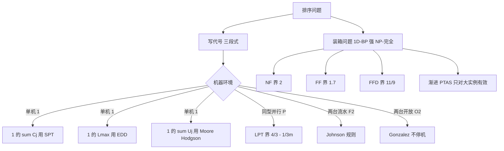

# 第 6 章：排序问题与装箱问题

- **难度**：★★★ | **预估学时**：6 小时 | **前置**：第 5 章（复杂性、近似比）

## 学习目标

学完本章，你能：

1. 用 α|β|γ 三参数记法把一句调度需求写成问题代号，也能反过来读懂别人的代号。
2. 说出 1||∑Cⱼ 用 SPT、1||Lₘₐₓ 用 EDD 为什么最优，各给出理由。
3. 手工跑 LPT 与 Johnson 规则，算出 makespan。
4. 用二参数记法写出装箱问题，并解释 NF、FF、BF、FFD 的区别。
5. 分清"排序问题的近似比"和"装箱问题的渐进近似比"，知道为什么要分这两种。

## 一句话核心

**排序问题研究"先干哪件、派给谁"，装箱问题研究"哪些塞一箱、用几箱"；前者关心时间轴上的先后，后者关心空间上的装满。两者都是 NP-难，但都有性质漂亮的特例和可以证明界的近似算法——摸清特例的边界，比记住算法名字重要得多。**

## 零基础讲解

### 概念 1：三参数记法（难度：基础）

排序问题的标准记法写成 **α | β | γ** 三段：

- **α 机器环境**：几台机器、什么关系。
- **β 工件特征**：有没有释放时间、交工期、先后约束。
- **γ 目标函数**：优化什么。

**α 的常用取值**：

| 记号 | 含义 |
|---|---|
| 1 | 单台机器 |
| P | 同型并行机（速度相同） |
| Q | 同类并行机（速度不同） |
| R | 无关并行机（速度依赖工件） |
| F | 流水车间（每件都要按同样顺序过各机器） |
| J | 作业车间（各件有各自的加工路线） |
| O | 开放车间（每件在每台机器上的次序任意） |

**β 的常用取值**：rⱼ（释放时间）、dⱼ（交工期）、pⱼ（加工时间）、prec（先后约束）、pⱼ = 1（所有工件加工时间相同）。

**γ 的常用取值**：

| 记号 | 目标 |
|---|---|
| Cₘₐₓ | 最大完工时间（makespan），让最后一件尽早完工 |
| ∑Cⱼ | 总完工时间，让所有件平均早点完成 |
| Lₘₐₓ | 最大延迟，max(Cⱼ − dⱼ)，最坏的那个不能拖太久 |
| ∑Tⱼ | 总延误，∑max(0, Cⱼ − dⱼ) |
| ∑Uⱼ | 误工工件数，拖期的件算 1 个 |

组合起来就是问题代号。书上举的例子：`1|rⱼ = d, dⱼ|∑Tⱼ` 表示单机、所有工件同时释放、交工期都是 d、目标是极小化总延误；`P2|prec|Cₘₐₓ` 表示两台同型机、有先后约束、最小化 makespan。

**学会读记法的好处**：看到代号就知道问题有多难。`1||∑Cⱼ` 有 O(n log n) 的最优算法，`1||∑Tⱼ` 就是 NP-难的——只差一个字母，难度差一个数量级。

### 概念 2：几个能精确求解的经典问题（难度：进阶）

**（1）1||∑Cⱼ：SPT 最优。** 单机、无约束、最小化总完工时间。结论：**按加工时间从短到长排序**（Shortest Processing Time）。

证明思路（交换论证）：若有两件相邻的 j（长）、k（短）且 j 在前，把它们换过来，j 与 k 各自的完工时间变化相互抵消，而**所有排在它们后面的工件都提前了**（提前 pⱼ − pₖ > 0）。所以"短在前"不会更差。反复交换，必得 SPT 顺序。

这个套路（"交换两个相邻元素，证明不变量变好"）在排序问题里反复出现，叫**交换论证**（exchange argument）。它比"贪心显然对"严谨得多。

**（2）1||Lₘₐₓ：EDD 最优**（定理 6.1）。最小化最大延迟。结论：**按交工期从早到晚排**（Earliest Due Date）。

证明也是交换论证。设某个最优排序里有两个相邻工件，前一个交工期 dⱼ > 后一个 dₖ。交换它们后，两个工件里**较晚的完工时间不会超过原来较晚的那个**，于是最大延迟不变差。反复交换就得到 EDD 顺序。

**（3）1||∑Uⱼ：Moore–Hodgson 算法。** 最小化误工件数。做法：按 EDD 排一遍，从头开始累加加工时间；一旦累加超过当前交工期，就把**已排的工件里加工时间最长的那件踢掉**（记为误工），继续。踢掉最长的，是为了给后面腾出最多时间——这是"用一个误工名额换最大空间"的贪心。

**（4）P||Cₘₐₓ：LPT 的 4/3 − 1/(3m) 界。** m 台同型机、最小化 makespan，是 NP-难的。**LPT**（Longest Processing Time first）：把工件按时间从长到短排，每次派给当前负载最小的机器。Graham 1969 年证明它的最坏情况界是

C_LPT / C* ≤ 4/3 − 1/(3m)

意思是 m 越大界越接近 4/3（m = 2 时界是 7/6 ≈ 1.167）。这个界是紧的。

对照：**LS**（List Scheduling，随便按某个顺序派给最闲的机器）的界是 **2 − 1/m**。所以"按长的先派"这个简单的改动，把界从 2 压到 1.33。

**（5）F2||Cₘₐₓ：Johnson 规则。** 两台机器、流水作业（每件都先上 M1 再上 M2）。最优规则：

1. 找出所有工件里加工时间最短的那个。
2. 若它在 **M1** 上，就排在**最前面**；若它在 **M2** 上，就排在**最后面**。
3. 删掉它，重复。

**（6）O2||Cₘₐₓ：Gonzalez 算法。** 两台机器、开放车间。结论很反直觉：**让每台机器一直忙、不停工，就能达到最优**——makespan 等于两台机器中负载较大的那个，即 max(总负载₁, 总负载₂)，下界直接可达。

### 概念 3：装箱问题（难度：进阶）

**装箱问题**（bin packing）：n 件物品，每件大小 aᵢ，箱子容量 B，用最少的箱子装完。记作 `1D-BP`，判定形式是"能否用 K 个箱子装下"。

它是**强 NP-完全**的（第 5 章的强 NP-完全：数值不随规模爆炸），所以**不存在伪多项式算法**，也没有 PTAS——只有**渐进近似比**（asymptotic approximation ratio）：当最优箱数趋于无穷时，算法用的箱数与最优之比趋于某个常数。

四个经典算法，区别只在"放哪个箱子"：

| 算法 | 规则 | 界 |
|---|---|---|
| **NF**（Next Fit） | 只看最后打开的那个箱子，放不下就开新箱 | ≤ 2·OPT |
| **FF**（First Fit） | 从头扫，放进第一个装得下的箱子 | ≤ 1.7·OPT |
| **BF**（Best Fit） | 放进"放完之后剩余空间最小"的那个箱子 | 界优于 FF 的常数 |
| **FFD**（First Fit Decreasing） | 先按大小从大到小排，再用 FF | ≤ 11/9·OPT + 6/9 |

FFD 那个 11/9 是装箱问题里最有名的常数，由 Johnson 等人证明，且是紧的。

**为什么 NF 差**：它一旦离开一个箱子就不再回来，那个箱子里剩下的空隙永久浪费。举个极端的例子：容量 10，物品 5, 6, 5, 6。

- NF：箱1 放 5（6 放不下）→ 箱2 放 6、5 放不下 → 箱3 放 5 → 箱4 放 6。用了 **4 个**。
- 最优：装箱思路是 (5,5) 一箱、(6) 一箱、(6) 一箱，共 **3 个**。

4/3 = 1.33，离 2 的界还有距离，但已经说明"不回头"的代价。

**渐进 PTAS**：de la Vega 和 Lueker 给出了箱数趋于无穷时近似比趋于 1+ε 的算法，但常数项不好——它不能保证"任意规模都接近最优"，只能保证"大实例接近最优"。这就是"渐进"二字的含义。

### 概念 4：物流里的组合优化（难度：进阶）

书上 6.4 节把镜头拉回现实，讲物流中的几类问题：

- **车辆路径问题（VRP）**：一堆客户各有需求量，若干辆车各有容量，怎么规划路线使总里程最短。它是 TSP 的推广（加了容量约束），也是 NP-难，实践中靠"节约算法 + 局部搜索"。
- **装载与配载**：三维装箱（3D-BP），要考虑承重、易碎、装卸顺序，实际约束比一维装箱复杂得多。
- **仓储拣选**：拣货员在仓库里走一趟要拿多个订单的货，路线规划本质是"带时间窗的 TSP"。

共同点：**模型要简化，但简化不能删掉关键约束**。把容量约束删掉，VRP 就退化成 TSP，算法快了，解却不能上路。

## 图示

**看图说明**：左支按机器环境分岔，每个叶子是一个"可精确求解"或"有确定界"的结论；右支是装箱问题的算法谱系，注意 N 那一格——它提醒你"渐进"不等于"任意规模都保证"。

## 类比与实例

### 类比：早餐摊的三口锅

你有三口锅（同型并行机），要煮若干份不同的东西，每份耗时不同。**LPT** 就是先把最耗时的下锅，然后哪口锅先空就往哪口锅里放。**LS** 是拿到什么就扔进最先空出来的锅。直觉上"长的先下"更稳，因为长任务一旦排在最后，会让某口锅空等很久——这正是 4/3 界的来源。

类比失效处：现实锅里可以中途加料、可以并行同一道工序，模型里工件是不可中断的整体。

### 实例 1：LPT 在 2 台机器上跑一遍

工件加工时间：7, 6, 4, 4, 2。两台机器 M1、M2。

| 步 | 工件 | M1 负载 | M2 负载 | 说明 |
|---|---|---|---|---|
| 1 | 7 | 7 | 0 | 派给空闲的 M1 |
| 2 | 6 | 7 | 6 | 派给 M2 |
| 3 | 4 | 7 | 10 | M2 更闲（6 < 7） |
| 4 | 4 | 11 | 10 | M1 更闲（7 < 10） |
| 5 | 2 | 11 | 12 | M2 更闲（10 < 11） |

makespan = 12。

**核对最优性**：总加工时间 7+6+4+4+2 = 23，两台机器理想下界是 11.5，所以至少 12。找到一个 12 的方案就说明最优：M1 放 7+4 = 11，M2 放 6+4+2 = 12 ✓。所以这个例子里 LPT 恰好最优。

**换成 LS 会怎样**：若按"2,4,4,6,7"这个顺序派，M1 会拿到 2+4+7 = 13，M2 拿 4+6 = 10，makespan 13 > 12。顺序选错，结果就差。

### 实例 2：Johnson 规则排两道工序

四件工件在两台机器上的加工时间：

| 工件 | M1 | M2 |
|---|---|---|
| J1 | 3 | 2 |
| J2 | 1 | 4 |
| J3 | 4 | 1 |
| J4 | 2 | 3 |

**按 Johnson 规则**：

- 全局最短是 1，出现在 J3 的 M2 上 → **J3 排最后**。
- 剩下 J1、J2、J4，最短是 1，在 J2 的 M1 上 → **J2 排最前**。
- 剩下 J1（M2 上 2 最短）、J4（M1 上 2）。最短是 2，出现在 J1 的 M2 上 → J1 排后面；于是顺序为 **J2, J4, J1, J3**。

**算 makespan**：

| | M1 时间轴 | M2 时间轴 |
|---|---|---|
| J2 | 0–1 | 1–5 |
| J4 | 1–3 | 5–8 |
| J1 | 3–6 | 8–10 |
| J3 | 6–10 | 10–11 |

makespan = **11**。

**穷举 24 种顺序核对**：最优值确实是 11（J2, J1, J4, J3 也能达到 11）。Johnson 规则给出的不是唯一最优，但一定最优。

**为什么规则有效**：如果最短时间在 M1 上，把它放最前，M1 一开工就有活干，M2 只能等它——所以它越早越好；如果在 M2 上，它放最后，正好让 M2 在末尾不空等。这条规则本质是把"会让机器等活的工件"推到两端。

### 实例 3：NF 为什么会浪费箱子

前面那个 5, 6, 5, 6（容量 10）的例子：NF 用了 4 箱，最优 3 箱。差别就在"箱 1 装了 5，剩下 5 的空隙，但 NF 再也不回头用它"。

**换成 FF**：物品 5 进箱 1（剩 5）；6 进不了箱 1，开箱 2；5 检查箱 1（剩 5，正好放下）→ 箱 1 满；6 检查箱 1、箱 2 都放不下，开箱 3。共 3 箱，等于最优。**同一个输入，只因为"回头看一眼"，就省了一个箱子。**

## 常见误解

- **别以为 SPT 对一切目标都好。** 它对 ∑Cⱼ 最优，但对 Lₘₐₓ 可能很差——短工件先做会把长工件拖到很晚，最大延迟爆掉。
- **别以为 EDD 能最小化 ∑Tⱼ。** 1||∑Tⱼ 是 NP-难的，EDD 不是最优，只是常用启发式。
- **别以为并行机上"平均分配"就好。** 平均分配只看负载数量，不看工件长度；LPT 之所以好，是因为它优先处理"无法被后补"的长工件。
- **别以为装箱有 PTAS 就能随便设精度。** 装箱只有**渐进** PTAS，小规模实例的保证很弱。
- **别以为 FFD 的 11/9 是"平均表现"。** 那是最坏情况界；实际数据上 FFD 常常就在最优附近。

## 自测题

1. **（单选）**`1||∑Cⱼ` 的最优算法是
   A. EDD　B. SPT　C. LPT　D. Johnson 规则
   **答案：B**。解析：按加工时间从短到长（SPT），可用交换论证证明任意违反该顺序的相邻对交换后总完工时间不变差。

2. **（单选）**`P||Cₘₐₓ` 的 LPT 算法最坏情况界是
   A. 2　B. 3/2　C. 4/3 − 1/(3m)　D. 11/9
   **答案：C**。解析：Graham 的经典结论；LS 的界才是 2 − 1/m，FFD 的 11/9 属于装箱问题。

3. **（填空）**Johnson 规则中，若最短加工时间出现在第二台机器上，该工件应排在______。
   **答案：最后**。解析：在 M2 上时间最短的工件放最后，可以让 M2 在末尾不空等；反之在 M1 上最短的放最前。

4. **（简答）**为什么 NF 算法的界是 2，而 FF 能到 1.7？
   **答案：** NF 只维护"当前打开的箱子"，一旦开新箱就不再回头，因此任意两个相邻箱子的物品总量之和必然超过容量（否则后一个箱子里的第一件就能放进前一个），由此推出箱数不超过 2·OPT。FF 会回头检查所有已开箱子，空隙利用更充分，所以常数更小（1.7）。

5. **（简答）**为什么装箱问题没有 PTAS，只有渐进 PTAS？
   **答案：** 装箱是强 NP-完全的。若存在 PTAS，就能在多项式时间内判定"用 K 个箱子能否装下"这类问题到任意精度，与强 NP-完全性矛盾（在 P ≠ NP 前提下）。渐进 PTAS 只保证"当最优箱数足够大时"近似比趋于 1+ε，小实例不受保证，因此绕开了这个矛盾。

## 复习锚点

- α|β|γ：机器环境、工件特征、目标函数，三段拼出一个问题代号。
- 单机三宝：∑Cⱼ 用 SPT，Lₘₐₓ 用 EDD，∑Uⱼ 用 Moore–Hodgson。
- 并行机 LPT 界 4/3 − 1/(3m)；LS 界 2 − 1/m。
- 两机流水 Johnson 规则；两机开放车间 Gonzalez（不停机即最优）。
- 装箱四算法 NF/FF/BF/FFD，界 2 / 1.7 / 更好 / 11/9；只有渐进 PTAS。
