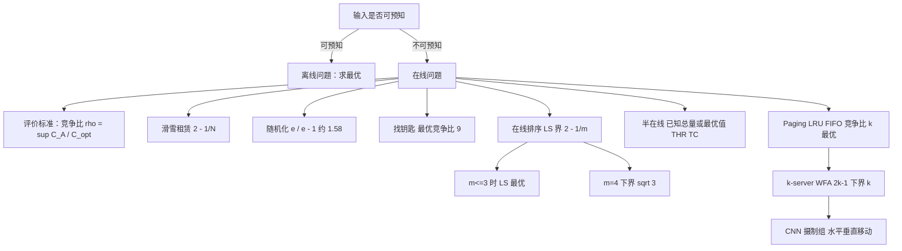

# 第 7 章：在线问题

- **难度**：★★★ | **预估学时**：5 小时 | **前置**：第 5 章（竞争比的思想基础）、第 6 章（排序问题）

## 学习目标

学完本章，你能：

1. 说清"在线"和"离线"的区别，并解释为什么在线问题不能用"最优值"做评价标准。
2. 写出竞争比的定义，并说明它为什么是一个"上确界"而不是"平均值"。
3. 推导滑雪租赁问题的 2 − 1/N 竞争比，说出随机化策略能好到多少。
4. 解释在线排序里 Graham 的 LS 为什么在 m ≤ 3 时是最优的，m = 4 又为什么卡在 √3。
5. 说出 Paging 与 k-server 的关系，以及 LRU 为什么是"最好的在线算法"。

## 一句话核心

**在线问题的决策者看不到未来，只能在信息不全时立刻行动；评价标准因此从"离最优多近"换成"最坏情况下比离线最优差几倍"，这个比值叫竞争比，它衡量的是策略的稳健性，而不是聪明程度。**

## 零基础讲解

### 概念 1：什么叫"在线"（难度：基础）

离线问题（前面各章）：所有数据一次性给你，慢慢算，算完再给答案。

在线问题：数据是**一个一个到达**的，每来一个你就得立刻决定，做完的决定不能反悔，而且你不知道下一个来什么、后面还有多少。

三个日常场景：

- **滑雪租赁**：你不知道自己会滑多少次，每次都在"租（1 元/次）"和"买（N 元，永久）"之间选。
- **找钥匙**：钥匙丢在一条直路的东西某个方向、某个距离，你不知道它在哪，只能来回找。
- **缓存置换（Paging）**：内存缓存只能放 k 页，来了新页面必须踢掉一个，你不知道接下来要访问哪些页。

在线问题的解叫**在线算法**，评价它的标杆是**离线最优**（假设你能预知全部输入时得到的最优解）。

严格地说，在线算法 A 对某个输入序列 σ 的花费 C_A(σ)，与离线最优 C*(σ) 之比，取所有序列的上确界，就是**竞争比**：

ρ_A = sup over σ of C_A(σ) / C*(σ)

它回答的是"最坏能差多少"，跟平均表现无关。

### 概念 2：滑雪租赁——一个能算到底的例子（难度：基础）

租金每次 1 元，购买价 N 元（N ≥ 1），你一共会滑 t 次（t 未知）。

**离线最优**：如果知道 t，答案显而易见——t ≤ N 就全程租（花 t），t > N 就第一天就买（花 N）。所以 C* = min(t, N)。

**一个自然的在线策略 A(k)**：先租 k−1 次，第 k 次如果还要滑，就买。

取 k = N：t < N 时全程租，花 t，与最优相同（比值 1）；t ≥ N 时花 (N−1) + N = 2N−1，而最优是 N，比值 (2N−1)/N = **2 − 1/N**。

所以这个策略的竞争比是 2 − 1/N。当 N 很大时逼近 2——**不管你多聪明，最坏情况下要付两倍的代价**。

**要不要用随机化？** 有。按某个分布随机选择购买时机，可以把期望竞争比降到 **e/(e−1) ≈ 1.58**。随机化在这里有效，是因为对手（输入序列）不知道你的随机数，无法针对你构造最坏输入。

**这个例子为什么经典**：它把"在线决策"的全部要素压缩到两个参数（租价、买价），却完整展示了"竞争比"的含义、下界的紧性、随机化的作用。看懂它，后面所有在线问题都是同一套语言。

### 概念 3：找钥匙——为什么是 9 倍（难度：进阶）

你站在一个交叉口，钥匙在东西某个方向、距离 d 处。你不知道方向也不知道距离，只能来回搜索。这个问题的离线最优成本就是 d（已知位置时直接走过去）。

书上比较了四个方案。方案 1 是 1,1,2,2,3,3,… 这样慢慢扩大，方案 2 是 2,2,4,4,6,6,… 扩大得快一点。**方案 4** 用的是等比翻倍：1, 1, 2, 4, 8, …（每一步把上一段再走一遍，然后向前翻倍）。

方案 4 的竞争比是 **9**，而且书上进一步用反证法证明：**任何方案的竞争比都不可能小于 9**。所以 9 就是这个问题的最优竞争比，方案 4 已经做到最好。

**为什么翻倍有效**：如果钥匙在距离 d 处，你最后一次搜索的范围大概是 2^k，而你之前来回走的总里程是几何级数，总和不超过最后一段的常数倍。等比扩大的"浪费"被控制在一个常数里；等差扩大（方案 1、2）则会让"来回次数"和"距离"同时增长，比值趋于无穷。

**关键教训**：在线策略的参数要用**几何级数**而不是等差，否则浪费会累积。这条经验在 TCP 拥塞控制的超时重传、在进度式搜索（如机器人寻路）里都能看到。

### 概念 4：在线排序与半在线（难度：高难）

**在线 P||Cₘₐₓ**：工件一个接一个到达，必须立刻派给某台机器，不许重排。Graham 的 **LS**（List Scheduling，每次派给当前负载最小的机器）竞争比是

2 − 1/m

而且这个界是**紧的**，更关键的是：**m = 2 和 m = 3 时，LS 就是最好的在线算法**（没有算法能做得更好）。所以 Graham 四十多年前给出的算法，到今天在小机器数下仍是最优的。

**m = 4 发生了变化**：Rudin 和 Chandrasekaran 在 2001 年证明 P4||Cₘₐₓ 的下界至少是 **√3 ≈ 1.732**，而当时最好的算法竞争比与之只差约 0.001。也就是说，**机器数从 3 增加到 4，问题的难度的性质变了**，为什么变，至今没有很好的解释。

**半在线**（semi-online）：给定一部分未来信息，比如"所有工件的总加工时间已知"或"最优值已知"。这类信息在现实中常常能拿到（订单总量、预算总额），利用它可以把竞争比压下来。书上的 **THR** 算法和 **TC** 算法（复合阈值）就是这一类。这也是谈之奕等人的研究方向（见参考文献里的多篇 Semi-online 论文）。

**为什么半在线值得研究**：它介于"完全无知"和"完全预知"之间，恰好是大多数现实场景的位置。只知道总量、不知道明细，就属于半在线。

### 概念 5：Paging——缓存该踢谁（难度：高难）

缓存容量 k 页，请求序列一页页到来。命中不花钱，未命中要把某页踢出去再读入，花 1 次。

**离线最优**是 **LFD**（Longest Forward Distance，也叫 Belady 算法）：踢掉"未来最晚才被用到"的那页。它需要预知未来，因此不可能在线实现。

**在线算法**：

- **LRU**（最近最少使用）：踢掉最久没被访问的页。
- **FIFO**（先进先出）：踢掉最早进来的页。
- **LIFO、LFU**：踢最新进来的 / 踢使用次数最少的。

结论（书上给的）：**LRU 和 FIFO 的竞争比都是 k**（k 是缓存容量），而且这是**最好可能的**——不存在竞争比小于 k 的确定性在线算法。**LIFO 和 LFU 的竞争比不是有限常数**，可以任意差。

**LRU 为什么是 k**：考虑一个精心构造的请求序列，让 LRU 每次都不命中，而离线最优只miss 很少。核心思路是"循环访问 k+1 个页面"——LRU 每次必踢掉即将要用的那个，每次都 miss；离线算法因为知道顺序，可以只 miss 一次。

### 概念 6：k-server 与 CNN（难度：高难）

**k-server 问题**：k 台服务器在一个度量空间里，请求点一个个到来，必须派一台服务器移动过去，代价是移动距离。目标是最小化总移动距离。Paging 是它的特例：**把"缓存里的 k 页"看成"k 台服务器所在的位置"，把"请求一页"看成"请求那个位置"**——不命中就等于把一台服务器移过去。

经典算法：

- **贪心（Greedy）**：派最近的服务器过去。
- **工作函数算法（WFA）**：维护"到目前为止的最优离线成本"，每次选择使"当前成本 + 未来最优"最小的动作。它的竞争比是 **2k − 1**。
- **下界是 k**：不存在竞争比小于 k 的算法（对一般度量空间）。所以 WFA 离最优只差一倍。

**CNN 问题**：书上用它收尾，很有意思。一家电视台（CNN）派一个摄制组去拍新闻，摄制组只能沿**水平或垂直的直线**移动（因为要沿街道走、要架设机位）。需求点出现时，摄制组只要**与它在同一行或同一列**就算"到达"（不必重合）。

**它与 k-server 的关系**：把摄制组"虚拟地一分为二"，一个专门负责水平移动、一个专门负责垂直移动，就变成了两台服务器的问题——但这两台服务器必须协同（同一次只能动一台）。这个转化说明：**看似奇怪的现实约束，往往可以翻译成已知模型的一个变种**。

## 图示

**看图说明**：主干只有一层判断——输入能不能预知。往下每个叶子是一个具体问题的"最好成绩"：滑雪 2、找钥匙 9、排序 2−1/m、缓存 k、k-server 2k−1。这些数字就是在线算法的"物理常数"，记下来比记算法步骤有用。

## 类比与实例

### 类比：没有地图的送外卖

离线像"提前拿到全部订单，规划一条最优路线"；在线像"每来一单就得立刻出发，不知道下一单在哪"。竞争比衡量的是"最倒霉的一天，你跑的路是理想情况的几倍"。

类比失效处：现实骑手可以拒单、可以预估热点区域；模型里输入完全对抗，这个"最坏情况"其实很少出现，所以竞争比差不代表实际差。

### 实例 1：滑雪租赁算一遍

设 N = 10（买装备 10 元，租一次 1 元）。

- 你只滑 3 次：最优花 3（全租）。策略"租 9 次再买"也只花 3，比值 1。
- 你滑 12 次：最优花 10（第一天就买）。你的策略在第 10 次买，总花费 9 + 10 = 19，比值 1.9。
- 你滑 100 次：最优 10，你花 19，比值仍是 1.9。

最坏比值出现在"刚好滑 N 次及以上"的情形，等于 2 − 1/10 = 1.9。**滑得越多，比值越稳定在 1.9**——这就是"上确界"的含义：某个点取到，之后不再变差。

### 实例 2：找钥匙的等比搜索为什么是 9

设钥匙在西向 d = 2 米处（最优路径就是走 2 米）。

按方案 4（1, 1, 2, 4, 8, …）搜索：向东 1 米、回来、向西 1 米、回来、向东 2 米、回来、向西 4 米——在走到西向 2 米处发现钥匙。

总里程：1 + 1 + 1 + 2 + 2 + 4 + 2 = 13 米（每次都从交叉口出发、回到交叉口）。比值 13/2 = 6.5。

若 d 恰好比某个搜索段稍长（比如 d = 8+ε），你要走完 1,1,2,4,8 再回头，总里程约 2(1+1+2+4+8) + 8 ≈ 40，比值约 5。最坏比值被证明恰好是 9，出现在"刚好错过一段"的位置。

**注意这里的计算方式**：每次都从交叉口出发，所以来回的路程要重复计算。如果允许"不回头、直接继续走"，方案会不同——**模型里"能不能回头"这个细节，会改变最优策略**。

### 实例 3：LRU 在循环访问下必败

缓存容量 k = 3，页面 A、B、C 已满。请求序列：D, A, B, C, D, A, B, C, …

- **LRU**：请求 D 不命中，踢掉最久未用的（假设是 A）→ 装入 D。请求 A 又不命中，踢 B → 装 A。……每次请求都不命中，**miss 率 100%**。
- **离线最优（LFD）**：知道接下来要用 A、B、C、D 循环，可以踢掉"下一次最晚用到"的那页，实际上每次也只 miss 一次，之后全命中。

这个构造说明：**LRU 的 k 倍界是紧的**，"最近最久未用"这条直觉在循环模式下完全失效。

## 常见误解

- **别以为在线算法的竞争比是"平均表现"。** 它是全序列的上确界，可以出现在非常极端的输入上。
- **别以为"离线最优"是可达的。** 它只是一个比较标杆，需要预知未来，在线算法永远拿不到。
- **别以为随机化能保证最坏情况更好。** 随机化改善的是**期望**竞争比；对手若知道你的分布，仍可构造坏序列。
- **别以为 m 越大在线排序越容易。** 反而是 m = 4 开始出现"下界与最好算法只差 0.001"的僵局，问题的结构性变化至今没解释清。
- **别以为 LFU 一定比 LRU 好。** LFU 的竞争比没有有限上界，遇到"一次性热点"会把缓存塞满垃圾。
- **别以为 Paging 和 k-server 是两个问题。** 前者是后者的特例，这条对应关系是整章最省力的记忆锚点。

## 自测题

1. **（单选）**竞争比 ρ_A 的定义是
   A. 平均花费与最优花费之比　B. 所有输入序列上 C_A/C* 的上确界　C. 最坏输入下的绝对花费　D. 算法运行时间的比值
   **答案：B**。解析：竞争比衡量"最坏情况下的相对差距"，取的是上确界（sup），不是平均。

2. **（单选）**滑雪租赁问题（租 1 元/次，买 N 元）的确定性最优竞争比是
   A. 2　B. 2 − 1/N　C. e/(e−1)　D. ln N
   **答案：B**。解析：租 N−1 次后购买，最坏花费 2N−1，与最优 N 的比值是 2−1/N；e/(e−1) 是随机化策略的期望竞争比。

3. **（填空）**在线排序 P||Cₘₐₓ 中，LS 算法的竞争比是______，且当 m = 2、3 时它是最优在线算法。
   **答案：2 − 1/m**。解析：Graham 的经典结论，界是紧的；m = 4 时下界变为 √3（Rudin–Chandrasekaran）。

4. **（简答）**为什么 LRU 的竞争比是 k，而不可能更好？
   **答案：** 存在一类"循环访问 k+1 个页面"的请求序列，使 LRU 每次都 miss（它总踢掉即将被用的那页），而离线算法只 miss 少数几次，比值达到 k。同时可以证明任何确定性在线算法的竞争比都不小于 k，所以 k 是这一类问题的最优值。

5. **（简答）**Paging 问题怎么变成 k-server 问题？
   **答案：** 把缓存中的 k 个页面看成 k 台服务器在"数据"这个度量空间中的位置；请求一页 = 请求该位置。命中表示已有服务器在那儿，不命中就要把一台服务器移过去，移动代价为 1。于是"踢一页、读一页"等价于"移动一台服务器"，Paging 就是 k-server 的特例。

## 复习锚点

- 在线 = 不知未来、立即决策、不可反悔；评价用竞争比（上确界）。
- 滑雪租赁 2−1/N；随机化 e/(e−1)；找钥匙 9；这两个是最经典的常数。
- 在线排序 LS 界 2−1/m，m ≤ 3 最优，m = 4 卡在 √3。
- Paging：LRU/FIFO 竞争比 k 且最优；LIFO/LFU 无有限界。
- k-server：WFA 竞争比 2k−1，下界 k；Paging 是它的特例，CNN 是它的变种。
