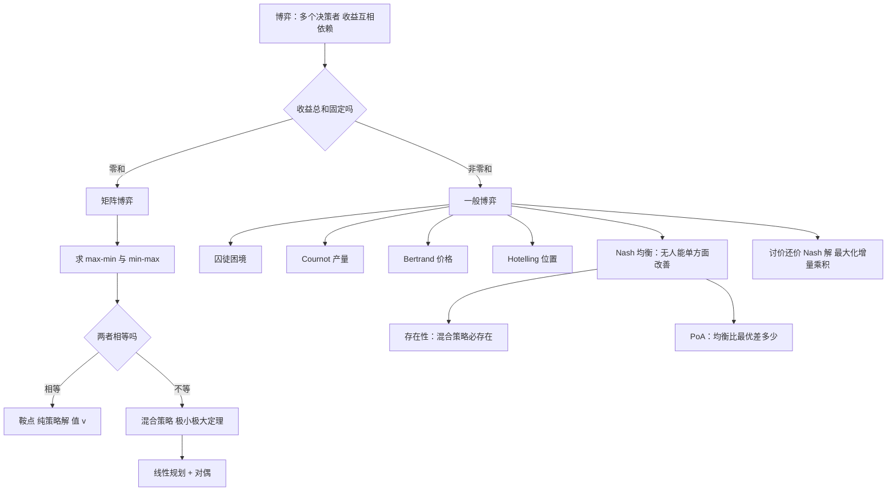

# 第 8 章：博弈论

- **难度**：★★★ | **预估学时**：6 小时 | **前置**：第 1 章（对偶、线性规划）、第 5 章（复杂性思想）

## 学习目标

学完本章，你能：

1. 写出一个零和博弈的收益矩阵，并判断它有没有鞍点（纯策略解）。
2. 用 max-min 与 min-max 的相等关系解释"博弈的值"，并说清它和线性规划对偶的关系。
3. 用最优反应法求出一个 2×2 博弈的 Nash 均衡（纯策略与混合策略各一例）。
4. 写出 Cournot 模型的反应函数并解出均衡产量；说清 Bertrand 为什么会导致"价格战到底"。
5. 用"最大化 (x−x₀)(y−y₀)"写出 Nash 谈判解，并解释这个乘积的含义。

## 一句话核心

**博弈论研究的是"你的收益取决于别人怎么选"的决策；它的核心结论只有一条——当每个人只能控制自己的策略时，唯一稳定的状态是"谁单方面改变都吃亏"，这个状态叫 Nash 均衡，而它未必是社会整体最优的。**

## 零基础讲解

### 概念 1：博弈论在研究什么（难度：基础）

博弈论（game theory）研究**存在利益冲突的多个主体，在相互依存的环境中如何决策**。

关键词是"相互依存"：你的收益不只由你的行动决定，还由别人的行动决定。这和前面几章的单人优化有本质区别——**优化问题里只有一个决策者，博弈问题里有多个，而且他们的目标可能相反**。

历史脉络（记住三个人名就够）：

- **von Neumann 与 Morgenstern**，1944 年《博弈论与经济行为》，把博弈变成一门数学学科。
- **Nash**，1950—1951 年提出非合作博弈的均衡概念，现在一切多人决策分析都绕不开它。
- 1994 年诺贝尔经济学奖授予 Nash、Harsanyi、Selten，博弈论正式进入主流经济学。

分类方式：

| 分法 | 两类 |
|---|---|
| 有没有强制约束力的协议 | 合作博弈 / 非合作博弈 |
| 收益总和是否固定 | 零和博弈 / 非零和博弈 |
| 信息是否完全 | 完全信息 / 不完全信息 |

本书主要讲**非合作、零和与简单的非零和**，这也是与运筹学关系最紧的部分。

### 概念 2：矩阵博弈——零和，你多我就少（难度：进阶）

两人零和博弈：甲选一行、乙选一列，收益矩阵 A = (aᵢⱼ)，aᵢⱼ 表示"甲得多少"。因为零和，乙的收益就是 −aᵢⱼ。

**甲的想法**：如果选第 i 行，最坏情况是乙挑了让 aᵢⱼ 最小的那一列。所以甲能保证的收益是

max over i of min over j of aᵢⱼ　（max-min，下界）

**乙的想法**：如果选第 j 列，最坏情况是甲挑了让 aᵢⱼ 最大的那一行。所以乙能保证甲不超过

min over j of max over i of aᵢⱼ　（min-max，上界）

一般有 **max-min ≤ min-max**（甲能保证的，不会超过乙能限制的）。当两者**相等**时，这个公共值 v 叫**博弈的值**，对应的策略叫**鞍点**（saddle point），双方都有了纯策略的最优选择。

**鞍点的判别**（实用判据）：某个元素 aᵢⱼ 是它**所在行的最小值**，同时又是它**所在列的最大值**，它就是鞍点。

**没有鞍点怎么办**：用**混合策略**——甲按概率分布 x 选行，乙按 y 选列。von Neumann 的**极小极大定理**说：**零和博弈的值一定存在**，混合策略下 max-min 与 min-max 必相等。

这个定理的证明用的正是第 1 章的工具：把"甲的最优混合策略"写成一个线性规划，把"乙的最优混合策略"写成它的对偶，强对偶定理直接给出两者相等。**这是全书最漂亮的一处呼应：对偶理论不只属于线性规划，它就是零和博弈的数学形式。**

### 概念 3：Nash 均衡——谁都不想单方面改（难度：进阶）

**囚徒困境**（Tucker 1950 年讲述）：两人被抓，分开审讯。各自可以"坦白"或"沉默"。

| 甲 \ 乙 | 坦白 | 沉默 |
|---|---|---|
| **坦白** | 各判 8 年 | 甲免罪，乙判 10 年 |
| **沉默** | 甲判 10 年，乙免罪 | 各判 1 年 |

把"判罚的相反数"当收益。甲发现：不管乙怎么选，"坦白"总比"沉默"好（乙坦白时 8 年 < 10 年；乙沉默时 0 年 < 1 年）。乙也一样。于是两人都坦白，各判 8 年——**而如果都沉默，只判 1 年**。

这就是困境：**每个人的理性选择，合起来是最差的结果**。

**Nash 均衡的严格定义**：设有 n 个参与者，第 i 个的策略集是 Aᵢ，收益函数 uᵢ。一个局势 a = (a₁,…,aₙ) 是 Nash 均衡，当且仅当**没有任何一个参与者能通过单方面改变自己的策略而提高收益**：

对每个 i 和每个 aᵢ′ ∈ Aᵢ，都有 uᵢ(a) ≥ uᵢ(a₁,…,aᵢ′,…,aₙ)

注意三件事：

1. **只要求"单方面"改不动**，不要求整体最优。囚徒困境里两人都坦白是 Nash 均衡，但收益远低于都沉默。
2. **纯策略均衡可能不存在**。石头剪刀布就没有：无论你出什么，对手换个出法就能赢你。
3. **混合策略均衡一定存在**（Nash 1951 的定理），证明用的是不动点定理。这是博弈论最重要的存在性结论。

**最优反应**是求均衡的实用方法：对每个参与者，算出"在别人选某个策略时，我最好选什么"，画出反应函数，交点就是均衡。

**无政府代价（Price of Anarchy, PoA）**：衡量"均衡有多糟"，定义为

PoA = 最坏均衡的社会总收益 / 最优社会总收益

囚徒困境里 PoA 大于 1（均衡比最优差）；书上还举了"集团谈判各自只顾小团体、被对手各个击破"的例子，PoA 可以趋于无穷——**这说明"每个人都理性"不等于"集体理性"**。

### 概念 4：三个经典经济模型（难度：进阶）

**（1）Cournot 模型（产量竞争）。** 两家企业生产同一种产品，总产量 Q = q₁ + q₂，市场价格 p = M − Q（M 是最高可接受价格），单位成本 c。

企业 1 的利润：π₁ = (p − c)q₁ = (M − q₁ − q₂ − c)q₁。对它关于 q₁ 求导并令其为 0：

q₁ = (M − c − q₂) / 2　（企业 1 的反应函数）

对称地 q₂ = (M − c − q₁)/2。两式联立：

q₁ = q₂ = (M − c) / 3，　p = (M + 2c) / 3

**为什么是这个数**：每家企业都假设对方产量不变，自己多产一点就多赚一点；但两家都这么想，总产量上去了，价格就下来了。均衡产量比"完全竞争"低、比"垄断"（两家合谋产 M−c 的一半）高。

**（2）Bertrand 模型（价格竞争）。** 同样的产品，两家比价格，消费者只买便宜的那家。

结论很极端：**均衡是 p₁ = p₂ = c**，也就是价格压到成本，利润为零。

理由：只要对手定价 p > c，我定价 p − ε 就能抢走全部市场且仍有利润；双方都这么想，价格一路压到成本。**两家企业就能实现完全竞争的结果**，这被称为"Bertrand 悖论"——现实里当然不会这样，因为存在产能限制、品牌差异、搜索成本。

**（3）Hotelling 模型（位置竞争）。** 一条线段代表一条街，消费者均匀分布，两家店选位置。消费者去最近的店。

结论：**两家都会挤在中点**（最小差异化）。因为只要对手不在中点，你往对手那边挪一点就能抢到更多客源；双方都挪，最后重合。

**三家企业时结论变了**：三家都挤在中点**不是**均衡——任意一家稍微偏一点，就能独占半边客源；而三家分散开也不是均衡。**三家时不存在纯策略 Nash 均衡**。这是"参与者数量改变问题结构"的又一个例子（和第 7 章 m = 4 的在线排序异曲同工）。

### 概念 5：讨价还价（难度：高难）

两人分一块蛋糕，怎么分才算"公平且理性"？

**Nash 谈判解**（1950）：设可行收益集合为 S（凸集），谈崩时的收益（ disagreement point）为 (x₀, y₀)。Nash 解是下面这个优化的唯一最优解：

max over (x,y) ∈ S of (x − x₀)(y − y₀)　s.t. x ≥ x₀，y ≥ y₀

**这个乘积的含义**：它衡量"双方的**增量**之积"。在总收益固定的情况下（x + y = 常数），这个乘积在**平分增量**时最大。所以 Nash 解在对称情形下就是"把多出来的部分对半分"。

**例**：S = {(x,y) | x + y ≤ 1，x,y ≥ 0}，谈崩点 (0,0)。最大化 xy 且 x+y ≤ 1，由均值不等式 xy ≤ ((x+y)/2)² ≤ 1/4，当 x = y = 0.5 时取到。所以各分一半。

**公理化刻画**：Nash 解是唯一满足四条公理的解——帕累托最优（不能还有提升空间）、对称性（双方条件相同则平分）、线性不变性（把收益按比例缩放不改变解）、无关替代独立性（删掉不会被选的选项不影响结果）。

**轮流出价（Rubinstein 1982）**：现实里谈判是多轮的。若双方轮流报价、每轮有时间成本（贴现因子 δ），子博弈精炼均衡给出的分配是

先出价者得 1/(1+δ)，后出价者得 δ/(1+δ)

**先出价者有优势**，而且 δ 越接近 1（时间成本越小），分配越接近平分。这条结论解释了一个现象：**谈判里"谁先开口"确实有实质优势**，不是心理作用。

### 概念 6：把博弈论放回运筹学（难度：进阶）

为什么一本运筹学教材要讲博弈论？三个接口：

1. **零和博弈 = 线性规划的对偶**。第 1 章的对偶理论在这里获得了一个"人"的解释：对偶变量是"对手的策略价值"。
2. **均衡是另一种"最优性"**。优化问"我该怎么选最好"，博弈问"大家都这么选时，谁会先改"。两种问题在建模上的差别，就是"有没有第二个决策者"。
3. **PoA 是系统设计的指标**。设计规则（拍卖、拥堵收费、排班制度）时，真正要保证的不是"最优解可达"，而是"均衡不要太糟"。这是运筹学从"算最优"走向"设计机制"的关键一步。

## 图示

**看图说明**：中间那个"收益总和固定吗"是分水岭。零和那一支最终落到"线性规划 + 对偶"，这正是它与第 1 章的接口；非零和那一支落到 Nash 均衡，而 Nash 均衡的核心是"单方面改不动"这个判据。

## 类比与实例

### 类比：抢最后一个座位的地铁

一节车厢只剩一个座位，两个人同时冲向它。谁先到谁坐——这是零和：一个人的收益正好是另一个人的损失。如果两人都谦让，可能都站着（非零和的坏均衡）。博弈论要问的不是"谁是好人"，而是"在什么规则下，理性人会怎么动"。

类比失效处：地铁里人还有"体面""不撞人"等隐性成本；模型里只有收益数字。

### 实例 1：一个 2×2 零和博弈求值

收益矩阵（甲选行、乙选列）：

| 甲 \ 乙 | 乙1 | 乙2 |
|---|---|---|
| **甲1** | 3 | −1 |
| **甲2** | −2 | 1 |

**先找鞍点**：甲1 行的最小值是 −1，甲2 行的最小值是 −2 → 行的最大 = −1。乙1 列的最大值是 3，乙2 列的最大值是 1 → 列的最小 = 1。max-min = −1 ≠ min-max = 1，**没有鞍点**，要算混合策略。

**设甲以概率 p 选甲1**，则甲1 的期望收益（对乙1、乙2）：
- 对乙1：3p + (−2)(1−p) = 5p − 2
- 对乙2：−1·p + 1·(1−p) = 1 − 2p

甲要让自己"最坏情况"尽量好，令两式相等：

5p − 2 = 1 − 2p　→　7p = 3　→　p = 3/7

此时期望值 = 1 − 2(3/7) = 1/7。所以**博弈的值 v = 1/7**，甲的策略是 (3/7, 4/7)。

**乙的策略对称算**：设乙以 q 选乙1，令甲选两行的期望相等：
- 甲1：3q + (−1)(1−q) = 4q − 1
- 甲2：−2q + 1(1−q) = 1 − 3q
4q − 1 = 1 − 3q → 7q = 2 → q = 2/7。乙策略 (2/7, 5/7)。

**核对**：把甲策略代入乙的两个列：5(3/7) − 2 = 1/7 ✓；1 − 2(3/7) = 1/7 ✓。双方都拿到 1/7，说明这就是值。

**这个 1/7 是怎么来的**：它等于 2×2 矩阵的"行列式除以元素和"——(3×1 − (−1)(−2)) / (3 + 1 + 2 + 1) = (3 − 2)/7 = 1/7。这个公式对 2×2 零和博弈通用，可以拿来验算。

### 实例 2：Cournot 均衡的数字版

M = 10，c = 1（即 p = 10 − q₁ − q₂，成本 1/件）。

- 反应函数：q₁ = (10 − 1 − q₂)/2 = (9 − q₂)/2。
- 对称均衡：q = (9 − q)/2 → 2q = 9 − q → 3q = 9 → **q = 3**。
- 两家各产 3，总产量 6，价格 p = 10 − 6 = 4。
- 每家利润 = (4 − 1)×3 = 9。

**对照垄断**：若两家合谋当一家，总产量 Q 满足 max (10 − Q − 1)Q → Q = 4.5，价格 5.5，总利润 20.25（每家 10.125）。**合谋比竞争赚得多**，但合谋不稳定——任一家偷偷多产一点就能多赚，这正是 Cournot 均衡的"囚徒困境"版本。

**对照完全竞争**：价格压到成本 c = 1，总产量 9。所以三种情形的产量排序是：竞争（9）> Cournot（6）> 垄断（4.5）。

## 常见误解

- **别以为 Nash 均衡就是"最优解"。** 它是"没人想单方面改"的稳定点，可能所有参与者都不满意（囚徒困境）。
- **别以为均衡一定存在纯策略。** 石头剪刀布、Hotelling 三家店都没有纯策略均衡；混合策略均衡的存在性另有定理保证。
- **别以为 max-min = min-max 总成立。** 一般只有一边大一边小；两者相等的特殊情形才叫有鞍点。
- **别以为 Bertrand 均衡"不现实"所以不重要。** 它恰恰说明了"产品同质 + 无产能限制"这个假设有多强；现实里加一条产能约束，结论立刻变（这叫 Edgeworth 修正）。
- **别以为 Nash 谈判解是"平分"。** 它最大化的是增量乘积；只有在对称且总收益固定时才刚好等于平分。
- **别以为 PoA 只是理论玩具。** 设计拥堵收费、拍卖规则、平台抽成时，PoA 是唯一的可计算指标。

## 自测题

1. **（单选）**零和博弈存在鞍点的充要条件是
   A. 收益矩阵对称　B. max-min = min-max　C. 所有元素非负　D. 参与者人数为 2
   **答案：B**。解析：鞍点意味着甲能保证的下界恰好等于乙能限制的上界，两者相等时公共值就是博弈的值。

2. **（单选）**囚徒困境中"双方都坦白"是
   A. 社会最优　B. Nash 均衡但非社会最优　C. 不是均衡　D. 帕累托最优
   **答案：B**。解析：任一方单方面改成沉默都会让自己判得更重，所以是均衡；但双方沉默的总判罚更轻，所以不是社会最优。

3. **（填空）**Cournot 模型中两家企业成本相同、需求 p = M − q₁ − q₂，均衡产量为 q₁ = q₂ = ______。
   **答案：(M − c)/3**。解析：由反应函数 q = (M − c − q)/2 解得 3q = M − c。

4. **（简答）**为什么说"零和博弈的值"和"线性规划的对偶"是同一件事？
   **答案：** 把甲的混合策略写成变量、约束"对每一列期望收益不低于 v"、目标最大化 v，得到一个线性规划；把乙的混合策略写成"对每一行期望损失不超过 w"、目标最小化 w，得到它的对偶。强对偶定理保证两者最优值相等，这个公共值就是博弈的值。所以极小极大定理就是 LP 对偶定理的一个解释。

5. **（简答）**Hotelling 模型里为什么三家店不存在纯策略均衡，而两家存在？
   **答案：** 两家时，任何偏离中点的位置都会被对手"贴过来"抢走客源，所以都挤在中点是稳定点。三家时，若都聚在中点，每家只分到 1/3；任意一家稍微偏向一侧就能独占那一侧超过半数的客源，因此中点不是均衡。而分散摆放时，总有一家可以移动位置获得更多客源。所以三家在任何位置组合下都有人想动，不存在纯策略均衡。

## 复习锚点

- 零和：max-min ≤ min-max，相等则鞍点；不等则用混合策略，值由 LP 对偶给出。
- Nash 均衡的判据只有一句：没人能单方面改变策略而获益。
- 纯策略均衡未必存在，混合策略均衡一定存在（Nash 定理）。
- Cournot 产量 (M−c)/3；Bertrand 价格压到成本；Hotelling 两家挤中点、三家无纯策略均衡。
- 谈判解最大化增量乘积；轮流出价里先开口者占优。
- PoA 衡量"理性个体的均衡"离"社会最优"有多远。
