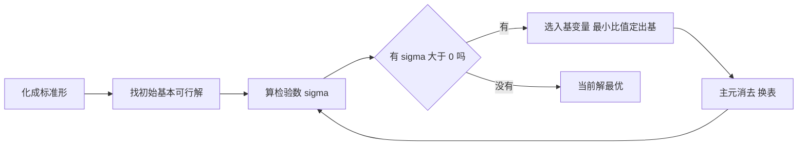

# 单纯形法

- **难度**：进阶 | **涉及章节**：第 1 章

## 一句话定义

单纯形法是解线性规划的系统方法：从一个顶点出发，沿着"让目标变好"的边走到相邻顶点，走到不能再好为止。

## 为什么重要

它是线性规划的通用解法，也是理解"为什么最优解在顶点""对偶是什么""割平面怎么加"的基础。后面第 3 章的割平面、第 8 章的博弈求值，都要回到单纯形表的语言。

## 图示

看这张图只要抓住一个循环：**算检验数 → 挑一个变好的方向 → 沿边走到下一个顶点 → 重新算**。循环终止的条件是"所有检验数都不大于 0"。

## 详解

线性规划的标准形要求：最大化、约束全是等式、变量全非负、右端项非负。任何原问题都能通过"加松弛变量、乘 −1、拆自由变量"转成标准形。

在等式约束 AX = b 下，取一组基 B（可逆子矩阵），令非基变量全为 0，得到 **基本解** x_B = B⁻¹b。若 x_B ≥ 0，它就是**基本可行解（BFS）**，几何上对应可行域的一个**顶点**。

关键定理：**若最优解存在，必在某个顶点取到**。所以只要在顶点之间走，就不会漏掉最优。

**检验数** σ_j = c_j − c_B^T B⁻¹ A_j，含义是"把非基变量 x_j 增加 1 个单位，目标能改善多少"。σ_j > 0 说明还有改进空间。

**最小比值规则**：选 θ = min{ b_i / a_ij : a_ij > 0 }，保证新解仍然可行（不越出可行域）。这一步是单纯形法里最容易算错的地方——分母只取正元素。

**退化与循环**：若最小比值出现并列，可能得到退化基本解（某个基变量取 0），理论上可能循环（Beale 1955 构造过例子）。Bland 1977 的规则（选最小的下标入基）可以保证不循环。

**两阶段法**：原问题没有明显初始可行基时，先引入人工变量、最小化人工变量之和，第一阶段把人工变量赶出去，第二阶段再优化原目标。

## 常见误解

- **别以为"最优解在顶点"无条件成立。** 前提是可行域非空、有界（或有最优值）；无界方向存在时可能无最优解。
- **别以为检验数大的变量一定该入基。** 那只是一种选法（最大改进法）；入基规则只影响速度，不影响正确性。
- **别以为退化就是错。** 退化只是基变量取 0，仍是合法解，只是可能原地打转。

## 在书中出现的脉络

| 章节 | 语境 | 关键结论 |
|---|---|---|
| 第 1 章 | 单纯形法、两阶段法 | 最优解在顶点；检验数判最优 |
| 第 1 章 | 对偶与影子价格 | 对偶最优解 = 最后一张表的检验数 |
| 第 3 章 | 割平面法 | 在 LP 松弛的最优表上加一行割 |

## 相关概念

- 前置：线性规划标准形、矩阵求逆
- 后续：[对偶与影子价格](c02-对偶与影子价格.md)、[割平面与分枝定界](c04-割平面与分枝定界.md)
