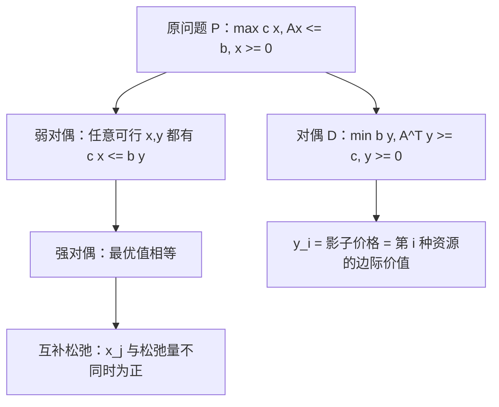

# 对偶与影子价格

- **难度**：进阶 | **涉及章节**：第 1 章、第 8 章

## 一句话定义

每个线性规划都有一个"影子问题"（对偶），它的最优值等于原问题的最优值；对偶变量的值告诉你"每多一单位资源，目标能多赚多少"，这就是影子价格。

## 为什么重要

对偶是全书出现频率最高的工具：第 1 章用它解释影子价格，第 2 章用它做位势法检验，第 8 章用它证明零和博弈的值存在。**不会对偶，这本书只能读懂一半。**

## 图示

看图重点：**两个问题共用一套数据（A、b、c），只是角色互换**——原来的约束变成对偶的变量，原来的变量变成对偶的约束。

## 详解

**构造对偶的三条规则**（对 max 型）：约束方向反转（≤ 变 ≥）、右端项 b 变成目标系数、目标系数 c 变成右端项、变量非负不变。

**四条定理**：

1. **弱对偶**：任一原可行解 x 与任一对偶可行解 y 满足 c x ≤ b y。含义：对偶值永远是原问题的上界。
2. **强对偶**：若两者都有可行解，则最优值相等。
3. **互补松弛**：最优解里，若 x_j > 0 则对应的对偶约束是紧的（等号成立）；若某个原约束有松弛（没用完），则对应的对偶变量为 0。
4. **对偶的最优解可从最终单纯形表读出**：松弛变量列的检验数就是 y 的分量。

**影子价格的经济含义**：y_i 是"第 i 种资源增加 1 单位时，最优目标值的增量"。它不是资源的市场价格，而是**在这个模型里的边际价值**。资源有剩余（约束松）时影子价格为 0——多给你也用不上。

**互补松弛怎么用**：拿到一张最优表，可以反推哪些约束是紧的、哪些变量为正，用来做解的合理性检查。

## 常见误解

- **别以为影子价格等于资源市价。** 它只反映模型内部的边际贡献，模型一改它就变。
- **别以为对偶最优解唯一。** 原问题退化时对偶可能有多重最优解，影子价格不唯一。
- **别以为强对偶总是成立。** 需要两边都可行；一边无界另一边就不可行。

## 在书中出现的脉络

| 章节 | 语境 | 关键结论 |
|---|---|---|
| 第 1 章 | 对偶理论四定理 | 强对偶、互补松弛 |
| 第 2 章 | 运输问题的位势法 | 位势 u、v 就是对偶变量，σ 就是检验数 |
| 第 8 章 | 零和矩阵博弈 | 博弈的值 = 一对互为对偶的 LP 的公共最优值 |

## 相关概念

- 前置：[单纯形法](c01-单纯形法.md)
- 后续：[最大流最小割](c06-最大流最小割.md)、[Nash 均衡](c10-Nash均衡.md)
