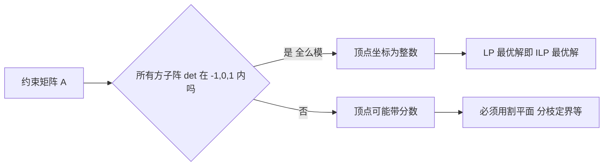

# 全么模与整数性

- **难度**：高难 | **涉及章节**：第 2 章、第 3 章

## 一句话定义

若矩阵 A 的每个方子阵行列式都是 0 或 ±1，就叫**全么模**；这样的约束矩阵能保证"顶点自动是整数点"，于是线性规划的解可以直接当整数解用。

## 为什么重要

整数规划一般很难，但有一类问题例外：约束矩阵全么模时，**LP 松弛的最优解天然是整数**，不用分枝也不用割平面。运输问题、指派问题都属于这一类，这是它们能用多项式算法求解的根本原因。

## 图示

看图重点：判断点在"行列式"那一格。行列式只能取 ±1 和 0，意味着求逆时不会出现分数。

## 详解

**为什么全么模就整数**：基本解 x_B = B⁻¹b。若 B 的行列式是 ±1，则 B⁻¹ 的元素全是整数（伴随矩阵除以 det，det = ±1 除不出分数）；再若 b 是整数向量，x_B 就是整数向量。

**运输问题的矩阵是全么模的**：它的约束矩阵每列只有两个 1（一个在行约束、一个在列约束），这种"每列至多两个非零元且符号相反"的结构叫**网络矩阵**，可以证明全么模。所以产销平衡的运输问题，LP 最优解自动是整数运输方案——这就是"表上作业法"敢直接调运量的理论依据。

**指派问题同理**：约束是"每行一个、每列一个"，也是全么模。

**反过来，不全么模就要小心**：第 3 章的例子里 LP 最优解是 (9/4, 15/4)，四分之三的出现就是矩阵不全么模的直接表现。

## 常见误解

- **别以为"约束全是整数"就一定有整数解。** 要看矩阵结构，不是看系数是否整数。
- **别以为全么模等于"所有元素是 0/±1"。** 元素可以是别的整数，关键是所有子阵行列式受限。
- **别以为全么模问题一定简单。** 判定一个矩阵是否全么模本身有算法，但问题规模大时仍要小心。

## 在书中出现的脉络

| 章节 | 语境 | 关键结论 |
|---|---|---|
| 第 2 章 | 运输问题 rank(A) = m+n−1 | 约束矩阵全么模，顶点整数 |
| 第 2 章 | 指派问题与匈牙利算法 | 全么模保证 LP 与 ILP 同解 |
| 第 3 章 | 割平面法 | 对照：不全么模时出现分数解 |

## 相关概念

- 前置：[对偶与影子价格](c02-对偶与影子价格.md)
- 后续：[割平面与分枝定界](c04-割平面与分枝定界.md)、[匹配与增广路](c05-匹配与增广路.md)
