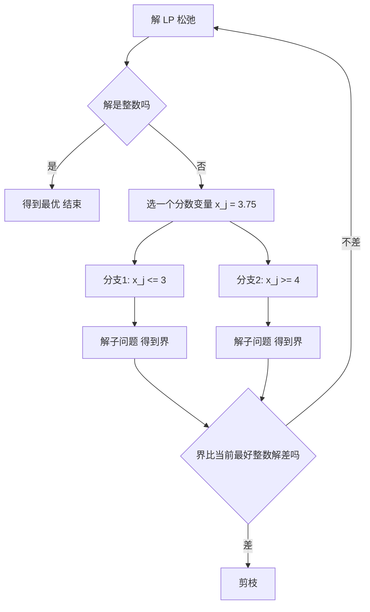

# 割平面与分枝定界

- **难度**：高难 | **涉及章节**：第 3 章

## 一句话定义

两种解整数规划的通法：**割平面**往可行域里"切一刀"削掉带分数的角，**分枝定界**把问题按变量的取值范围"劈成两半"分别求解，用界来剪掉没希望的分支。

## 为什么重要

这是整数规划的两大主力算法，几乎所有商用求解器（CPLEX、Gurobi）的内核都是这两者的组合。理解它们，才能理解"为什么整数规划比线性规划难那么多"。

## 图示

看图重点：剪枝条件是"这个分支的界已经不如手上已有的整数解"。**界越紧，剪得越早，算法越快。**

## 详解

**割平面（Gomory）**：在 LP 最优表里找一行，右端项是分数；把该行拆成"整数部分 + 分数部分"，得到一个新的不等式，它**对所有整数可行解都成立，但恰好切掉当前这个分数顶点**。加进去重解 LP，直到解变整数。

书上例子的关键两步：从 x₁ + (9/4)x₃ − (1/4)x₄ = 9/4 推出 x₃ + 3x₄ ≥ 1，等价于 4x₁ + 7x₂ ≤ 35；再加一刀 2x₁ + 3x₂ ≤ 15，最终得到整数解 (3,3)。

**分枝定界**：解 LP 松弛得到上界（max 问题）；一旦某个分支拿到整数可行解，就用它更新下界；任何分支的 LP 上界低于当前下界就剪掉。书上例子：根 −202.5 → 分支 x₁ ≥ 3 得 (3,3) = −198（更新下界）→ 另一边 −200 被剪、(9/5,4) = −198 被剪。

**两者的关系**：割平面是"改约束"，分枝定界是"改范围"，现代求解器两者混用（branch and cut）。

## 常见误解

- **别以为 LP 松弛解取整就能用。** 取整可能不可行、可能离最优很远（第 3 章的三重失败就是例子）。
- **别以为割平面越多越好。** 割太多会让 LP 变慢、数值不稳定，实际要控制数量和深度。
- **别以为分枝定界一定要遍历全树。** 好界能让它只走很小一部分。

## 在书中出现的脉络

| 章节 | 语境 | 关键结论 |
|---|---|---|
| 第 3 章 | 例 3.1 | 取整三重失败：(9/4,15/4)=−202.5，(2,4) 不可行，(2,3)=−168 |
| 第 3 章 | Gomory 割推导 | 4x₁+7x₂ ≤ 35，再 2x₁+3x₂ ≤ 15 |
| 第 3 章 | 分枝定界树 | 根 −202.5 → (3,3)=−198 |

## 相关概念

- 前置：[单纯形法](c01-单纯形法.md)、[全么模与整数性](c03-全么模与整数性.md)
- 后续：[NP-完全与归约](c07-NP完全与归约.md)
