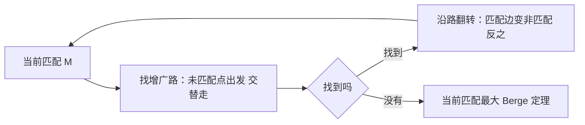

# 匹配与增广路

- **难度**：进阶 | **涉及章节**：第 2 章、第 4 章

## 一句话定义

匹配是"把点两两配对且不重复"；增广路是一条"从头到尾交替走未匹配边和匹配边、两端都未匹配"的路，沿着它换边就能让匹配多一条。

## 为什么重要

指派问题、婚配问题、排班问题都是匹配。**Berge 定理**给出判定最优的判据，**匈牙利算法**和 **Edmonds 花算法**给出求解方法，这一套是组合优化里最经典的结构。

## 图示

看图重点：整个算法就是"不断找增广路 → 翻转"。终止条件由 Berge 定理保证正确。

## 详解

**Berge 定理**：匹配 M 是最大匹配，当且仅当不存在增广路。这条定理把"最优性"转化成一个可搜索的结构。

**二分图**：点分成左右两边，边只跨两边。二分图的最大匹配有匈牙利算法（本质是反复找增广路），复杂度 O(VE)。

**一般图**：奇环（花）会让增广路搜索失效，Edmonds 的**花算法**把奇环缩成一个点继续搜索，从而解决一般图匹配。

**König 定理**：二分图中"最大匹配的大小 = 最小顶点覆盖的大小"。这条对偶关系是二分图理论的核心，也是很多证明的工具。

**Hall 婚配定理**：二分图存在饱和左侧所有点的匹配，当且仅当左侧任意 k 个点的邻居总数 ≥ k。这是"匹配存在性"的充要条件。

## 常见误解

- **别以为"每个点都有边"就能匹配上。** Hall 条件看的是"任意子集的邻居数"，不是单点的度数。
- **别以为一般图和二分图算法通用。** 奇环会让朴素增广失效，必须用花算法。
- **别以为最大匹配唯一。** 大小唯一，具体方案可能多解。

## 在书中出现的脉络

| 章节 | 语境 | 关键结论 |
|---|---|---|
| 第 2 章 | 指派问题与匈牙利算法 | 4×4 例子最优 15，逐轮减、划、补 |
| 第 4 章 | 匹配、Berge 定理、Edmonds 花算法 | 增广路判最优 |
| 第 4 章 | König 定理、Hall 定理 | 匹配与覆盖的对偶 |

## 相关概念

- 前置：[全么模与整数性](c03-全么模与整数性.md)
- 后续：[最大流最小割](c06-最大流最小割.md)
