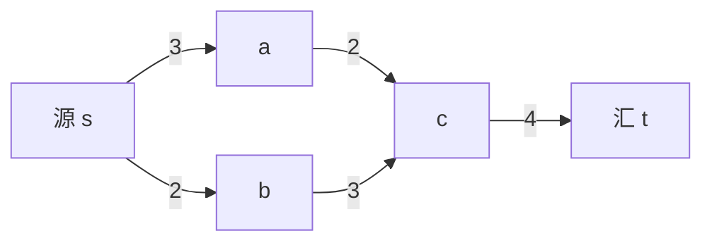

# 最大流最小割

- **难度**：进阶 | **涉及章节**：第 4 章

## 一句话定义

在一个带容量的网络里，从源点到汇点能送出的最大流量，正好等于把源和汇分开所需切掉的最小容量——两者永远相等。

## 为什么重要

这是网络优化里最漂亮的对偶定理，也是"最小割 = 最大流"这一整类问题的基石。运输、通信、图像分割、项目调度都靠它。

## 图示

这个网络的最大流是 4，最小割是 c→t 这条边（容量 4）。看图时可以自己验：s 出来的总容量只有 5，但 a、b 到 c 的总容量是 5，c 到 t 只有 4，所以卡在 4。

## 详解

**Ford–Fulkerson 方法**：在**残余网络**里不断找增广路（还能再送流量的路径），找到就沿着它加压，直到找不到为止。残余网络里**反向边**是关键——它允许"撤销"之前的流量分配，这是算法正确的核心。

**为什么反向边重要**：贪心地先送一条路可能堵住更好的分配，反向边给了"反悔"的机会。没有反向边，算法会卡在局部最优。

**Edmonds–Karp**：把找增广路改成 BFS（每次找最短的增广路），复杂度 O(VE²)，避免 Ford–Fulkerson 在无理容量时的慢收敛。

**最小割怎么找**：最大流结束后，在残余网络里从 s 出发能到达的点集记 S，其余记 T，(S,T) 就是一个最小割。

**最小费用最大流**：在"流量最大"的前提下让总费用最小，做法是每次沿"单位费用最省"的增广路加压（用最短路找路），是运输问题的一般化。

## 常见误解

- **别以为"送满每条边"就是最大流。** 中间瓶颈会限制总量，要看割。
- **别以为增广路必须走"没用过的边"。** 残余网络里反向边也算通路。
- **别以为最大流唯一。** 流量值唯一，具体分配可能多种。

## 在书中出现的脉络

| 章节 | 语境 | 关键结论 |
|---|---|---|
| 第 4 章 | 最大流最小割定理 | maxflow = mincut = 4（书上自拟网络） |
| 第 4 章 | Ford–Fulkerson 与 Edmonds–Karp | 残余网络 + 反向边 |
| 第 4 章 | 最小费用最大流 | 最短路增广 |

## 相关概念

- 前置：[匹配与增广路](c05-匹配与增广路.md)
- 后续：[近似比与 PTAS](c08-近似比与PTAS.md)
