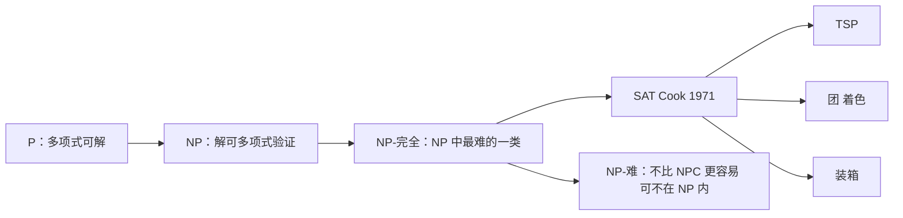

# NP-完全与归约

- **难度**：高难 | **涉及章节**：第 5 章、第 6 章

## 一句话定义

如果一个问题属于 NP（解可以在多项式时间内被验证），且所有 NP 问题都能多项式归约到它，它就是 **NP-完全**的；归约的意思是"把 A 的实例改写成 B 的实例，使得答案保持一致"。

## 为什么重要

它给出"这个问题有多难"的严格说法。判定一个问题是 NP-完全的，就等于说"别指望找到多项式算法（除非 P = NP）"，从而把精力转向近似算法、特殊情形或启发式。

## 图示

看图重点：P ⊆ NP ⊆ NP-难 的层次关系，以及"从 SAT 出发的归约树"——第一个 NP-完全问题是 Cook 证明的 SAT，其余都是归约过去的。

## 详解

**四个盒子**：

- **P**：有多项式算法。
- **NP**：解能在多项式时间验证（不要求能构造）。
- **NP-完全**：在 NP 里，且所有 NP 问题都能归约到它。
- **NP-难**：所有 NP 问题都能归约到它，但它自己可以不在 NP 里（如优化版的 TSP）。

**归约的方向不能搞反**：要证"问题 B 是 NP-完全的"，做法是"取一个已知 NP-完全问题 A，把 A 的实例多项式时间改写成 B 的实例，且答案一致"。也就是 **A ≤ₚ B**，把已知难的往新问题上靠。

**两步证明套路**：

1. 证 B ∈ NP（给出解，能在多项式时间验证）。
2. 证 A ≤ₚ B（写出改写方法，并证明"A 有解 ⇔ B 有解"）。

**结构决定难度**：第 5 章的四组对照最能说明问题——最短路好解、最长路难解；2-着色好解、3-着色难解；指派好解、三维指派难解。**约束只加了一点点，难度跨一个数量级。**

**强 NP-完全**：若问题的数值被规模的多项式界住（B(I) ≤ p(x(I))），则它是强 NP-完全的；强 NP-完全问题**不存在伪多项式算法**（定理 5.2）。这解释了为什么背包有 O(nC) 的 DP，而 TSP、装箱没有。

## 常见误解

- **别以为"我没想到多项式算法"就等于 NP-完全。** 需要严格归约。
- **别以为 NP-完全问题绝对无解。** 小规模精确算法、特殊结构、近似算法都可行。
- **别以为归约方向可以反过来。** 方向反了证明的是另一件事。
- **别以为伪多项式算法是多项式算法。** O(nC) 里 C 是数值，不是规模。

## 在书中出现的脉络

| 章节 | 语境 | 关键结论 |
|---|---|---|
| 第 5 章 | P/NP/NPC/NP-hard 四盒 | Cook 1971、Karp 1972 |
| 第 5 章 | 结构决定难度四对照 | 最短路 vs 最长路等 |
| 第 5 章 | 强 NP-完全（定义 5.5、定理 5.2） | 无伪多项式算法 |
| 第 6 章 | 装箱是强 NP-完全 | 只有渐进 PTAS |

## 相关概念

- 前置：[割平面与分枝定界](c04-割平面与分枝定界.md)
- 后续：[近似比与 PTAS](c08-近似比与PTAS.md)、[竞争比](c09-竞争比.md)
