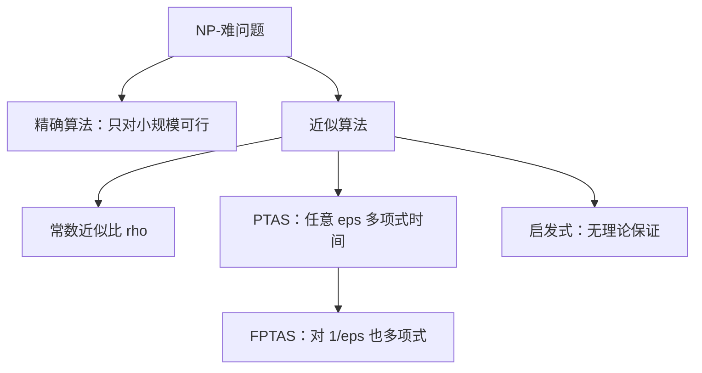

# 近似比与 PTAS

- **难度**：高难 | **涉及章节**：第 5 章、第 6 章

## 一句话定义

近似比 ρ 是"算法解的目标值 / 最优值"的最坏上界；PTAS 是一族算法，对任意 ε > 0 都能在多项式时间（ε 固定时）内做到 1+ε 的近似。

## 为什么重要

NP-难问题求不了精确最优，工程上全靠近似算法。近似比是"能承诺什么"的合同条款，PTAS/FPTAS 是"能承诺到什么程度"的分级。

## 图示

看图重点：从"有常数界"到"任意精度"是一条越来越强的阶梯，FPTAS 是最高一档。

## 详解

**近似比定义**：对最小化问题，ρ = max over 实例 of (C_A / C*)；最大化问题反过来。ρ = 1 表示最优，ρ = 2 表示最坏差一倍。

**要证明 ρ，需要两件事**：给出算法的上界（A 的解得 ≤ ρ·OPT），并给一个实例说明界是紧的（不能更小）。

**经典例子**：

- 顶点覆盖的 2-近似（取极大匹配，两端都选）。
- TSP 的 MST 双树法 2-近似（MST ≤ OPT，2MST ≤ 2OPT，三角不等式抄近路不增成本）。
- 装箱 FFD 的 11/9。

**背包的贪心反例**：容量 10，物品 A(6, 价值 7)、B(5,5)、C(5,5)。贪心按性价比先拿 A，得 7；最优是 B+C 得 10。比值 10/7 ≈ 1.43，说明"按性价比贪心"没有常数界（换个例子可以任意差）。

**PTAS 与 FPTAS**：PTAS 的运行时间可以是 n^{1/ε}（ε 固定时是多项式）；FPTAS 要求对 1/ε 也是多项式（如 O(n³/ε)）。背包有 FPTAS（价值缩放 + DP），装箱只有**渐进** PTAS。

**为什么装箱没有 PTAS**：装箱是强 NP-完全的，PTAS 会与强 NP-完全性矛盾（在 P ≠ NP 下）。渐进 PTAS 只对大实例保证，绕开这个矛盾。

## 常见误解

- **别以为 ρ = 2 就是"平均差一倍"。** 那是最坏情况。
- **别以为启发式有名字就有保证。** 最近邻、模拟退火大多没有理论界。
- **别以为 PTAS 一定实用。** n^{1/ε} 在 ε = 0.01 时是 n^100，理论好看，实际跑不动。

## 在书中出现的脉络

| 章节 | 语境 | 关键结论 |
|---|---|---|
| 第 5 章 | 近似比定义、背包反例 | 贪心 7 vs 最优 10 |
| 第 5 章 | GK/CK、MST 双树 | ρ = 2 |
| 第 5 章 | PTAS/FPTAS、PKP_ε | 价值缩放 |
| 第 6 章 | 装箱 11/9 与渐进 PTAS | 强 NP-完全的限制 |

## 相关概念

- 前置：[NP-完全与归约](c07-NP完全与归约.md)
- 后续：[竞争比](c09-竞争比.md)
