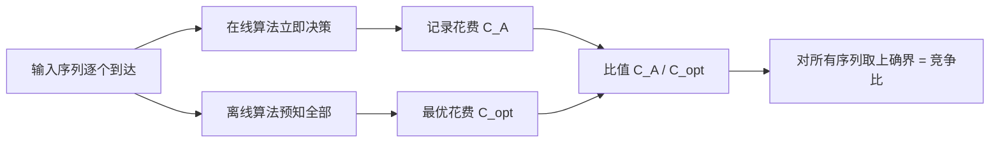

# 竞争比

- **难度**：进阶 | **涉及章节**：第 7 章

## 一句话定义

在线算法 A 的竞争比是"对所有输入序列，A 的花费与离线最优花费之比"的上确界；它衡量最坏情况下要付几倍代价。

## 为什么重要

在线问题没有"最优解"可比（未来未知），竞争比是唯一严格的评价标准。它是第 5 章近似比思想在"信息不全"场景下的对应物。

## 图示

看图重点：两条分支用同一个输入序列，比值取最坏。**它不是平均，是上确界。**

## 详解

**几个基准数字**（记住了就等于记住了整章）：

| 问题 | 最好竞争比 | 说明 |
|---|---|---|
| 滑雪租赁 | 2 − 1/N | 随机化可到 e/(e−1) ≈ 1.58 |
| 找钥匙（线性搜索） | 9 | 等比翻倍方案，且被证明最优 |
| 在线 P\|\|Cₘₐₓ | 2 − 1/m | m ≤ 3 时 LS 最优 |
| Paging | k | LRU、FIFO 达到，且是下界 |
| k-server | 2k − 1 | 工作函数算法；下界 k |

**常用证明手法**：

- **构造坏实例**：设计一个输入序列，让算法每次都做错（如 LRU 的循环访问）。
- **势函数/分摊分析**：给状态定义一个"势"，证明每一步的真实花费 + 势的变化 ≤ ρ·最优花费。
- **几何级数**：在线策略的参数（搜索步长、租买时机）要用等比，避免浪费累积。

**半在线**：给定部分信息（总量已知），可以改善竞争比。这是现实中更常见的情形。

## 常见误解

- **别以为竞争比小就一定实际好。** 它对抗的是"最坏输入"，实际数据往往温和得多。
- **别以为随机化能改善最坏情况。** 它改善的是期望值。
- **别以为离线最优可达。** 它只是标杆。

## 在书中出现的脉络

| 章节 | 语境 | 关键结论 |
|---|---|---|
| 第 7 章 | 滑雪租赁 | 2 − 1/N |
| 第 7 章 | 找钥匙 | 最优 9 |
| 第 7 章 | 在线排序下界 | 2 − 1/m；m=4 下界 √3 |
| 第 7 章 | Paging、k-server、CNN | k；2k−1 |

## 相关概念

- 前置：[近似比与 PTAS](c08-近似比与PTAS.md)
- 后续：[Nash 均衡](c10-Nash均衡.md)（同为"多主体/信息不全"的决策模型）
