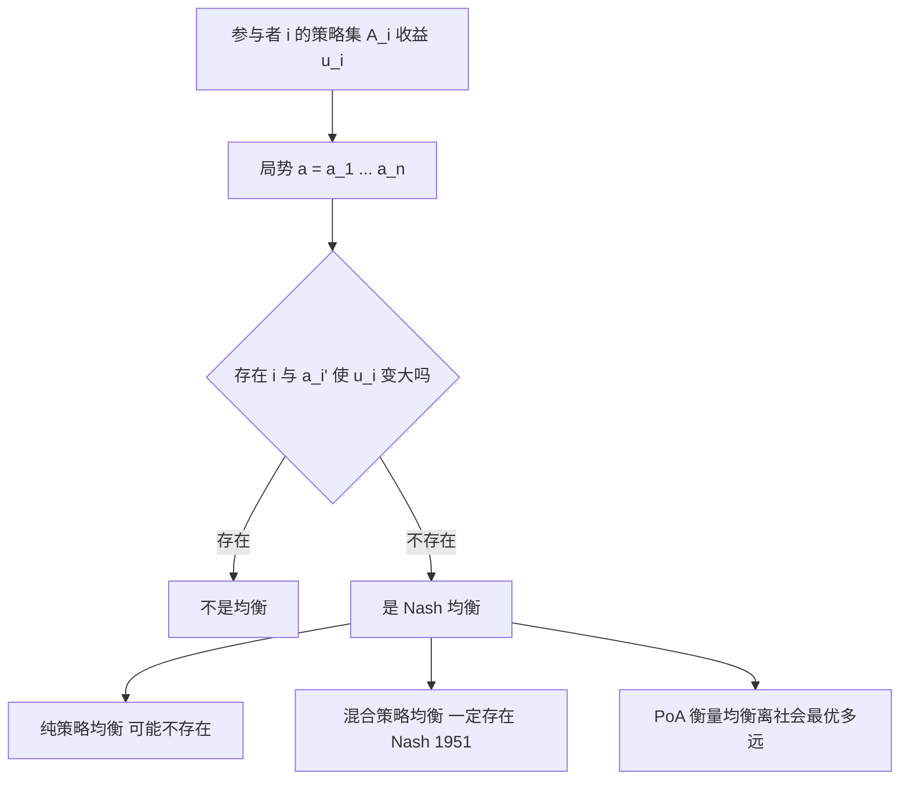

# Nash 均衡

- **难度**：进阶 | **涉及章节**：第 8 章

## 一句话定义

在一个多人博弈里，如果没有任何一个参与者能通过**单方面**改变自己的策略而获得更高收益，这个局势就是 Nash 均衡。

## 为什么重要

它是"多人决策"里唯一稳定的状态，也是分析市场、拍卖、谈判、交通的通用语言。它的两个关键性质——**未必最优**（囚徒困境）、**未必存在纯策略**（石头剪刀布）——构成了整章的主线。

## 图示

看图重点：判定只有一句"能不能单方面变好"。存在性分纯策略（可能没有）与混合策略（一定有）。

## 详解

**严格定义**：对每个 i 与每个 aᵢ′ ∈ Aᵢ，uᵢ(a) ≥ uᵢ(a₁,…,aᵢ′,…,aₙ)。

**最优反应法**：解"在别人策略固定时我的最佳选择"这个方程组，交点即均衡。

**2×2 例子**（囚徒困境型）：只要每个参与者的"背叛"在每个情形下都优于"合作"，双方背叛就是唯一的纯策略均衡。

**混合策略例子**（零和 2×2）：甲以 p 选甲1 使两列期望相等，得 p = 3/7，值 = 1/7。

**存在性**：Nash 1951 用 Brouwer 不动点定理证明"有限博弈的混合策略均衡一定存在"。这是博弈论最核心的定理。

**PoA**：最坏均衡的社会总福利 / 最优社会总福利。囚徒困境的 PoA > 1；书上"各自只顾小团体、被各个击破"的例子 PoA 可趋于无穷。

**三个经典模型**：

- **Cournot**：产量竞争，反应函数 q = (M − c − q')/2，均衡 q = (M − c)/3。
- **Bertrand**：价格竞争，均衡 p = c（价格战到底）。
- **Hotelling**：位置竞争，两家挤中点；三家无纯策略均衡。

## 常见误解

- **别以为均衡 = 最优。** 囚徒困境的均衡是最差结果。
- **别以为没有纯策略均衡就没有均衡。** 混合策略均衡由 Nash 定理保证存在。
- **别以为"理性"能带来好结果。** 理性个体 + 无协调 = 可能集体受损，这正是 PoA 的意义。
- **别以为先出价没差别。** Rubinstein 模型里先出价者分得 1/(1+δ)，比后出价者多。

## 在书中出现的脉络

| 章节 | 语境 | 关键结论 |
|---|---|---|
| 第 8 章 | 矩阵博弈、鞍点 | max-min = min-max 时纯策略解 |
| 第 8 章 | 囚徒困境（Tucker 1950） | 均衡非最优 |
| 第 8 章 | Nash 定义与存在性 | 混合策略必存在 |
| 第 8 章 | Cournot / Bertrand / Hotelling | 均衡产量、价格、位置 |
| 第 8 章 | 讨价还价 | 最大化增量乘积；轮流出价 |

## 相关概念

- 前置：[对偶与影子价格](c02-对偶与影子价格.md)、[竞争比](c09-竞争比.md)
- 延伸：机制设计、拍卖理论
