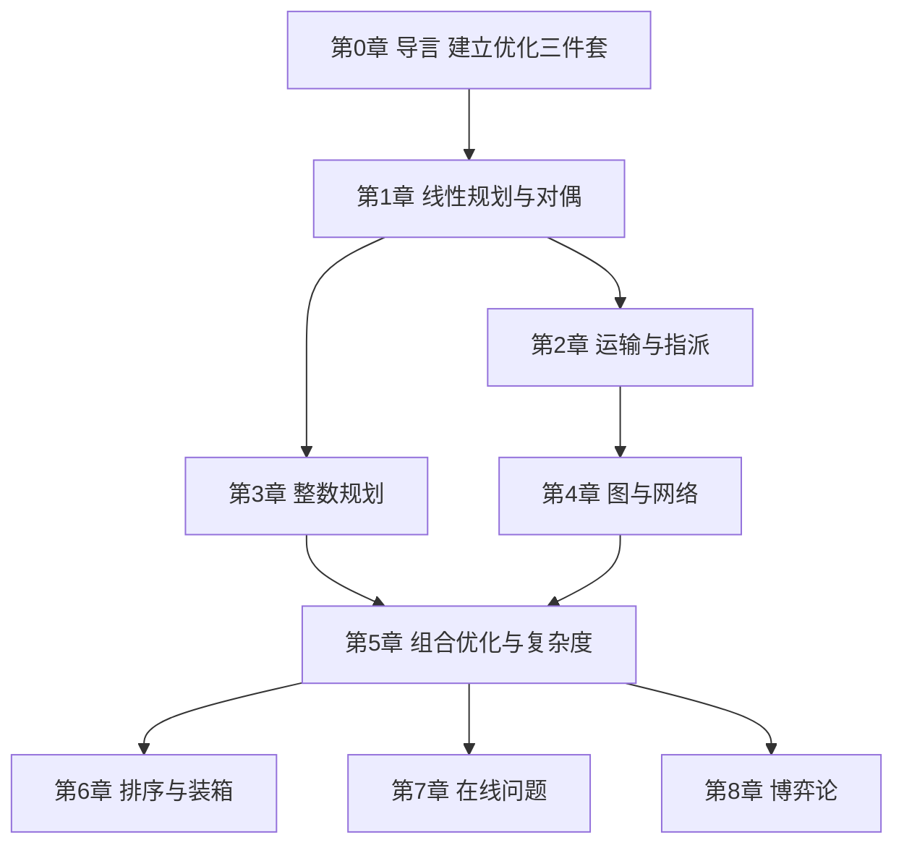

# 学习路径：从零到能建模

面向零基础、以"能自己建模并选对算法"为终点的 8 步路径。每一步都有明确检查点，通过再往下走。

## 路径总览

## 步骤 1：导言——把"优化"说清楚

**目标**：能用"决策变量 / 目标函数 / 约束条件"三件套描述一个生活问题，并分清连续与离散。
**阅读**：`chapters/ch00-导言.md`
**检查点**：完成本章自测题 ≥ 4/5；能自己举一个"局部最优不是全局最优"的例子。
**复习**：抽认卡标签 `基础`

## 步骤 2：线性规划与对偶

**目标**：能手算一张单纯形表；能写出对偶并解释影子价格。
**阅读**：`chapters/ch01-线性规划.md`
**检查点**：独立复算 ch01 的两张单纯形表（x = (4,2)，值 14）；自测题 ≥ 4/5。
**复习**：`c01-单纯形法`、`c02-对偶与影子价格`

## 步骤 3：运输与指派

**目标**：会用最小元素法 + 位势法解产销平衡问题；会跑匈牙利算法。
**阅读**：`chapters/ch02-运输与指派.md`
**检查点**：复算 3×3 运输例子（最优 43）；复算 4×4 指派（最优 15）。
**复习**：`c03-全么模与整数性`、`c05-匹配与增广路`

## 步骤 4：整数规划

**目标**：能说明"为什么不能直接取整"，会写一个 Gomory 割，会画分枝定界树。
**阅读**：`chapters/ch03-整数规划.md`
**检查点**：复算例 3.1 的四个值（−202.5 / −198 / −168 / 不可行）；自测题 ≥ 4/5。
**复习**：`c04-割平面与分枝定界`

## 步骤 5：图与网络

**目标**：会跑 Kruskal、Dijkstra、Ford–Fulkerson；能说出最大流最小割的对应。
**阅读**：`chapters/ch04-图与网络优化.md`
**检查点**：复算 6 点图的 MST（13）与 Dijkstra 距离；复算最大流 = 4。
**复习**：`c06-最大流最小割`

## 步骤 6：组合优化与复杂度

**目标**：能判断一个问题属于 P / NP / NP-完全 / NP-难；会写一个归约的两步证明。
**阅读**：`chapters/ch05-组合优化.md`
**检查点**：能自己举出三组"结构决定难度"的对照；自测题 ≥ 4/5。
**复习**：`c07-NP完全与归约`、`c08-近似比与PTAS`

## 步骤 7：排序与装箱

**目标**：会读 α|β|γ 代号；会跑 LPT 与 Johnson 规则；知道 NF/FF/BF/FFD 的区别。
**阅读**：`chapters/ch06-排序与装箱.md`
**检查点**：复算 LPT 的 makespan = 12、Johnson 的 makespan = 11。
**复习**：抽认卡标签 `排序`

## 步骤 8：在线问题与博弈论

**目标**：会算竞争比；会求 2×2 零和博弈的值；会用最优反应求 Nash 均衡。
**阅读**：`chapters/ch07-在线问题.md`、`chapters/ch08-博弈论.md`
**检查点**：复算滑雪租赁 2 − 1/N；复算 2×2 博弈值 1/7；自测题各 ≥ 4/5。
**复习**：`c09-竞争比`、`c10-Nash均衡`

## 学完全程后

- **你能**：把一个现实问题写成 LP/ILP/图模型；判断它难不难；为它选一个算法并说清保证。
- **综合检验**：见 `quiz.md` 的"最终检验"——给一个物流场景，完整走一遍"建模 → 判定难度 → 选算法 → 估误差"。
- **进阶**：内点法、列生成、半正定松弛、机制设计。
